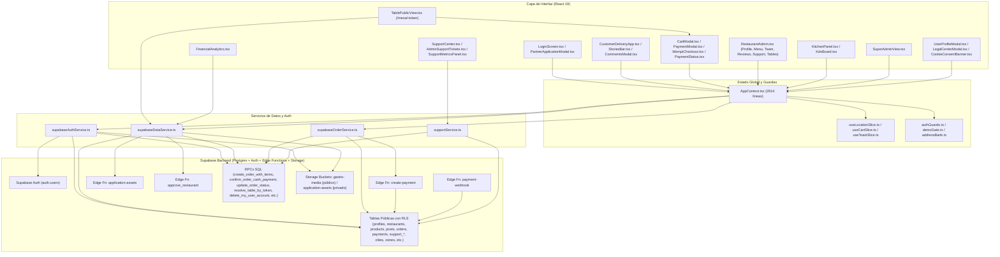

# Auditoría Técnica Integral — GastroSync Colombia

**Fecha de auditoría:** 2026-10-12  
**Rama auditada:** `main` (`2f7fb19 Actualizacion de historias`)  
**Modo de ejecución:** Estrictamente **SOLO LECTURA** (0 modificaciones a código de producto, migraciones, políticas RLS, Storage, Edge Functions ni variables de entorno).  
**Alcance:** Fases 0 a 12 completas (Frontend React 19 + TypeScript + Vite 8, Estado Global, Servicios Supabase, 59 archivos de migración SQL `001`–`057`, RLS, RPC `SECURITY DEFINER`, Storage Buckets, 4 Edge Functions, Pagos Wompi/Efectivo, QR de Mesa, Paneles Operativos, Soporte Humano, Multi-ciudad, Cumplimiento Legal Colombia Ley 1581/2012 y Rendimiento Móvil).

---

## 1. Resumen Ejecutivo

### 1.1 Estado General del Proyecto
GastroSync cuenta con una interfaz visual cuidada ("Warm Gastronomy Identity") y una arquitectura funcionalmente ambiciosa que abarca feed social gastronómico, historias de 24 horas, comercio electrónico multi-modalidad (domicilio, recogida en local y servicio a la mesa con QR), pasarela de pagos Wompi con cálculo de comisión neta del 3%, panel de restaurante con KDS/cocina, soporte humano y panel de superadministración.

Sin embargo, la inspección técnica línea por línea demuestra que **el proyecto NO está listo para operar con tráfico real en producción en su estado actual**. Aunque el proyecto compila sin errores (`tsc -b`, `vite build`), pasa el linter (`oxlint`) y aprueba sus 12 tests (`npm test`), existen **8 hallazgos críticos (P0)** y **18 hallazgos de severidad alta (P1)** que rompen flujos esenciales en la base de datos o exponen datos personales y financieros sensibles.

### 1.2 Conteo Exacto de Hallazgos por Severidad

| Severidad | Cantidad | Descripción de Impacto |
| :--- | :---: | :--- |
| **P0 — Crítico** | **8** | Ruptura total de soporte en BD (migración `054`), exposición pública masiva de PII y direcciones residenciales en `profiles` (`USING (true)`), filtración de notas internas de soporte a clientes/restaurantes, fallo SQL 100% en baja/purga de restaurante (`056`), bloqueo de checkout anónimo en Mesa QR (`/mesa/:token`), secuestro de restaurantes vía RPC (`045`), suplantación de rol en cliente vía `localStorage` y captura directa de PAN/CVV de tarjetas en DOM + desvío de métodos de pago. |
| **P1 — Alto** | **18** | Pantalla de verificación de correo inalcanzable (`EmailVerificationScreen`), recuperación de contraseña rota (`/reset-password`), historias 24h que se filtran como posts permanentes, pérdida de logo/banner al aprobar restaurantes, degradación de `platform_admin` en `approve_restaurant`, polución anónima de ciudades/zonas (`053`), escalada de `staff` a `owner` en UI, IDOR y crash en soporte, repartidores y checklist KDS 100% volátiles/locales, `auth.users` intacto tras supresión de cuenta, pagos de liquidación auto-aprobables sin pasarela, y suite de tests basada en regex estáticos. |
| **P2 — Medio** | **14** | Guardados (`saved_posts`) sin vista en UI, archivos huérfanos en Storage al borrar productos/posts, fallo de GPS pegado, numeración duplicada de migraciones (`053`/`054`), fugas de canales Realtime, bundle inicial > 500 kB, falta de cabeceras de seguridad en `vercel.json`, falta de `"strict": true` en TS, desbordamiento móvil en tablas, colisión de banner de cookies con barra inferior móvil, uso de `window.confirm`/`alert` y ausencia de Focus Trap/Scroll Lock en modales. |
| **P3 — Bajo** | **6** | Touch targets < 44px, botones de ícono sin `aria-label`, código muerto (`LocationSelector`, `ForcePasswordModal` remoto), `console.log` en pagos/órdenes, diferencias de redondeo local vs SQL y ausencia de CI/CD. |
| **TOTAL** | **46** | **46 hallazgos verificados con trazabilidad exacta `archivo:línea`.** |

### 1.3 Los 5 Riesgos Más Urgentes Antes de Salir a Producción

1. **Exposición pública total de datos personales y direcciones de entrega (`P0-02`):** La migración `047_reviews_photos_replies_and_profile_upsert.sql:66-70` creó la política `profiles_select_public_meta` con `FOR SELECT TO anon, authenticated USING (true)` sobre `public.profiles`. Cualquier visitante anónimo puede ejecutar `supabase.from('profiles').select('*')` y descargar nombres completos, teléfonos, dirección principal y el banco completo de ubicaciones (`saved_addresses` con direcciones de casa, oficina y notas de portería agregadas en `057`) de todos los usuarios de Colombia.
2. **Sistema de soporte humano 100% inoperante en base de datos (`P0-01`) + Exposición de notas internas (`P0-03`):** La migración `054_qa_security_and_payment_hardening.sql:264-450` reescribió 4 funciones trigger de soporte para insertar en tablas inexistentes (`public.support_ticket_events` y `public.notifications`) y consultar una columna inexistente (`profiles.role = 'admin'`). Cualquier creación o actualización de ticket o mensaje falla con error PostgreSQL. Además, cuando existen mensajes previos, las notas internas (`is_internal = true`) se envían y muestran a clientes y restaurantes.
3. **Captura de tarjetas (PAN/CVV) en DOM y desvío engañoso de medios de pago (`P0-08`):** `PaymentModal.tsx:1071-1145` captura el número de tarjeta, fecha de expiración y CVV directamente en inputs controlados de React (riesgo PCI-DSS y contradicción directa con la Política de Privacidad en `LegalCenterModal.tsx:202`), para luego ignorarlos en modo remoto y abrir el widget de Wompi (`createRemotePayment(res.orderId, 'sandbox')`). Seleccionar `MercadoPago` tampoco usa MercadoPago sino Wompi.
4. **Secuestro de restaurantes (`P0-06`) y suplantación de rol administrativo en interfaz (`P0-07`):** El RPC `provision_restaurant_for_user` (`045:9-42`) es `SECURITY DEFINER`, ejecutable por cualquier usuario autenticado sin validar `p_user_id = auth.uid()`, permitiendo reclamar solicitudes de restaurante ajenas conociendo el email del solicitante. En el frontend, `AppContext.tsx:87-97, 258-281` confía en `localStorage.getItem('gs_demo_session_v1')` incluso cuando `authMode === 'remote'` y la sesión de Supabase es `null`, permitiendo abrir los paneles de SuperAdmin y Restaurante desde el navegador.
5. **Flujo de Mesa QR anónimo bloqueado en checkout (`P0-05`) y purga de restaurante rota en SQL (`P0-04`):** El comensal que escanea un QR en `/mesa/:token` sin cuenta es bloqueado por `AppContext.tsx:1256-1259` (`"Debes iniciar sesión para realizar un pedido."`) y por la Edge Function `create-payment/index.ts:54-95` (que exige JWT y `order.customer_id === user.id`). Por su parte, el RPC `deactivate_and_purge_my_restaurant` (`056:229-255`) falla siempre porque intenta actualizar 5 columnas que no existen (`restaurants.bio`, `cover_url`, `payout_holder_name` y `profiles.restaurant_id`, `role`).

---

## 2. Metodología y Alcance Verificado

### 2.1 Comandos de Verificación No Destructivos Ejecutados

| Verificación | Comando Ejecutado | Resultado | Interpretación Técnica |
| :--- | :--- | :--- | :--- |
| **Estado de Git** | `git status --short --branch` | `## main...origin/main` (árbol limpio) | Confirmado en commit `2f7fb19`. |
| **Linter Estático** | `npx oxlint src` | `Found 0 warnings and 0 errors in 72 files (113ms)` | Confirmado por lint: sin errores sintácticos de Oxlint. |
| **Chequeo de Tipos** | `npx tsc -b` | Salida `0` (sin errores) | Confirmado por compilación TS (nota: `tsconfig.app.json` no activa `"strict": true`). |
| **Pruebas Automatizadas** | `npm test` | `12 passed, 0 failed (146.5ms)` | **Engañoso:** 9 de 12 tests son `fs.readFileSync` + regex sobre el código fuente; 3 prueban funciones locales copiadas en el propio test (`tests/qa-payment-and-security.test.mjs`). |
| **Build de Producción** | `npm run build` | Exitoso en `2.46s` | Chunk principal `dist/assets/index-DaUKmcjX.js` pesa **524.42 kB** (`156.71 kB` gzip), disparando advertencia de Vite (>500 kB). |

### 2.2 Niveles de Evidencia Utilizados en este Informe
Cada afirmación en este documento especifica su nivel de evidencia:
- **[Confirmado por inspección estática]:** Verificado directamente en el código fuente TypeScript/React, SQL de migraciones o Deno Edge Functions con ruta y líneas exactas.
- **[Confirmado por build/lint/test]:** Verificado mediante ejecución de `tsc -b`, `vite build`, `oxlint` o `node --test`.
- **[Requiere prueba manual]:** Comportamientos visuales en dispositivos físicos iOS/Android o flujos interactivos de navegador.
- **[Requiere verificación contra Supabase remoto/producción]:** Estado real de las tablas, políticas y secretos (`Deno.env`) actualmente aplicados en la instancia remota de Supabase y en el panel de Vercel.

---

## 3. Mapa de Arquitectura Real del Sistema (Fase 0)

### 3.1 Inventario de Estructura y Configuración Base
- **Frontend:** React `^19.2.8`, React DOM `^19.2.8`, TypeScript `~6.0.2`, Vite `^8.2.2`, `@supabase/supabase-js` `^2.116.0`, `framer-motion` `^13.2.0`, `lucide-react` `^1.43.0`, `recharts` `^3.10.1`, `canvas-confetti` `^1.9.4` ([package.json](file:///c:/Users/Juan%20Manuel/Desktop/GastroSync/package.json#L13-L32)).
- **Variables de entorno públicas (`.env.example`):** `VITE_SUPABASE_URL` y `VITE_SUPABASE_PUBLISHABLE_KEY` ([.env.example](file:///c:/Users/Juan%20Manuel/Desktop/GastroSync/.env.example#L7-L10), leídas en [src/lib/supabase.ts](file:///c:/Users/Juan%20Manuel/Desktop/GastroSync/src/lib/supabase.ts#L4-L16)).
- **Modo de operación (`authMode`):** Si `isSupabaseConfigured` es `true` (ambas variables existen y no son placeholders), `AppContext` opera en `authMode = 'remote'`; de lo contrario cae silenciosamente a `authMode = 'demo'` con datos locales de [src/context/defaultData.ts](file:///c:/Users/Juan%20Manuel/Desktop/GastroSync/src/context/defaultData.ts#L1-L218) ([src/context/AppContext.tsx](file:///c:/Users/Juan%20Manuel/Desktop/GastroSync/src/context/AppContext.tsx#L100-L102)).
- **Enrutamiento SPA:** No utiliza `react-router-dom`. El enrutamiento se resuelve manualmente en [src/App.tsx](file:///c:/Users/Juan%20Manuel/Desktop/GastroSync/src/App.tsx#L28-L122):
  1. Si `window.location.pathname` coincide con `/^\/mesa\/([^/]+)\/?$/` (`App.tsx:28-36`), renderiza `<TablePublicView publicToken={...} />` sin exigir sesión.
  2. Si hay query param `?legal=privacy|terms|cookies|rnbd`, [src/components/LegalCenterModal.tsx](file:///c:/Users/Juan%20Manuel/Desktop/GastroSync/src/components/LegalCenterModal.tsx#L23-L36) se abre automáticamente como modal global.
  3. Para el resto de rutas, la vista depende exclusivamente del estado `userRole` en `AppContext` (`'login'`, `'client_delivery'`, `'admin'`, `'kitchen'`, `'platform_admin'`, `'table_qr'`).

### 3.2 Diagrama de Trazabilidad: Frontend → Contexto → Servicio → Supabase (Tablas / RPC / Edge Functions / Storage)



### 3.3 Relación Exacta de Módulos, Servicios y Objetos de Base de Datos

| Flujo / Vista Frontend | Contexto / Hook | Servicio (`src/services/*`) | Tabla / RPC / Edge Function en Supabase | Bucket Storage / Realtime |
| :--- | :--- | :--- | :--- | :--- |
| **Login / Registro / OAuth / Perfil** (`LoginScreen.tsx`, `UserProfileModal.tsx`) | `AppContext` (`loginWithCredentials`, `registerAccount`, `updateUserProfile`) | `supabaseAuthService.ts` (`signInWithSupabase`, `signUpWithSupabase`, `resolveSupabaseUserProfile`, `updateSupabaseUserProfile`) | `auth.users`, tabla `public.profiles`, RPC `resolve_or_provision_restaurant_owner`, RPC `provision_restaurant_for_user` | Bucket `gastro-media` (`avatars/{uid}/...`) |
| **Solicitud de Restaurante Aliado** (`PartnerApplicationModal.tsx`) | `AppContext` (`submitRestaurantApplication`) | `supabaseDataService.ts` (`ensureColombiaCityAndZone`, `submitLiveApplication`, `uploadApplicationAssets`) | RPC `ensure_colombia_city_and_zone`, tabla `public.restaurant_applications`, Edge Fn `application-assets` | Bucket privado `application-assets` (vía signed upload URL) |
| **Aprobación en SuperAdmin** (`SuperAdminView.tsx`) | `AppContext` (`approveApplicationAndActivate`, `updateApplicationStatus`) | `supabaseDataService.ts` (`activateApprovedRestaurant`, `updateLiveApplicationStatus`) | Edge Fn `approve_restaurant` (primario) → fallback RPC `activate_approved_restaurant_rpc` | Lee `application-assets` |
| **Feed, Historias, Likes, Comentarios, Guardados** (`CustomerDeliveryApp.tsx`, `StoriesBar.tsx`, `CommentsModal.tsx`) | `AppContext` (`posts`, `activeStories`, `toggleLikePost`, `addPostComment`, `toggleSavePost`, `createStoryItem`) | `supabaseDataService.ts` (`fetchLivePosts`, `createLivePost`, `deleteLivePost`, `toggleRemoteLike`, `addRemoteComment`, `deleteRemoteComment`) | Tablas `posts`, `post_likes`, `post_comments`, `saved_posts`, RPC `toggle_post_like` | Bucket `gastro-media` (`posts/`, `stories/`) |
| **Menú y Catálogo** (`MenuTab.tsx`, `CustomerDeliveryApp.tsx`) | `AppContext` (`products`, `addProduct`, `updateProduct`, `deleteProduct`) | `supabaseDataService.ts` (`fetchLiveProducts`, `createLiveProduct`, `updateLiveProduct`, `deleteLiveProduct`) | Tabla `public.products` | Bucket `gastro-media` (`products/`) |
| **Checkout, Pedidos y Pagos** (`CartModal.tsx`, `PaymentModal.tsx`, `WompiCheckout.tsx`, `PaymentStatus.tsx`) | `AppContext` (`submitOrderWithPayment`, `confirmCashPayment`, `updateOrderStatus`) | `supabaseOrderService.ts` (`createLiveOrder`, `createRemotePayment`, `confirmCashPayment`, `updateLiveOrderStatus`) | RPC `create_order_with_items`, Edge Fn `create-payment`, Edge Fn `payment-webhook`, RPC `confirm_order_cash_payment`, RPC `update_order_status`, tablas `orders`, `order_items`, `payments`, `payment_audit_log` | Realtime en `public.orders` y `public.payments` + canal broadcast `table_orders_sync_{tableId}` |
| **Mesa QR Pública** (`TablePublicView.tsx`) | Estado local + `useApp` (`submitOrderWithPayment`, `addToCart`) | `supabaseDataService.ts` (`resolvePublicTableByToken`, `fetchTableOrdersForSession`) | RPC `resolve_table_by_token`, RPC `get_table_orders_for_session`, tabla `restaurant_tables` | Canal broadcast `table_orders_sync_{tableId}` |
| **Equipo de Restaurante** (`TeamTab.tsx`) | `AppContext` (`inviteStaffMember`, `suspendMember`, `revokeMember`) | `supabaseDataService.ts` (`fetchRestaurantMembers`, `inviteRestaurantStaff`, `updateMemberStatus`) | Tabla `restaurant_members`, RPCs `invite_restaurant_staff`, `update_member_status`, `accept_restaurant_invitation`, `resend_restaurant_invitation` | N/A |
| **Finanzas y Liquidaciones** (`FinancialAnalytics.tsx`, `SuperAdminView.tsx`) | Estado local + `useApp` (`orders`, `currentTenant`) | `supabaseDataService.ts` (`fetchRestaurantFinancialSummary`, `recordRestaurantSettlementPayment`, `fetchAdminPlatformSettlementOverview`) | RPCs `get_restaurant_financial_summary`, `record_restaurant_settlement_payment`, `get_admin_platform_settlement_overview`, `admin_review_restaurant_settlement`, tabla `restaurant_settlements` | N/A |
| **Soporte Humano** (`SupportCenter.tsx`, `SupportTab.tsx`, `AdminSupportTickets.tsx`, `SupportMetricsPanel.tsx`) | Estado local en cada vista | `supportService.ts` | Tablas `support_tickets`, `support_messages`, `support_audit_log`, `support_notifications`, `support_ticket_feedback`, RPC `get_support_metrics` | Polling cada 30s en `NotificationBell.tsx` |
| **Privacidad y Supresión (Ley 1581)** (`UserProfileModal.tsx`, `ProfileTab.tsx`, `LegalCenterModal.tsx`) | `AppContext` (`deleteMyAccount`, `deleteMyRestaurant`) | `supabaseDataService.ts` (`deleteMyUserAccountRemote`, `deactivateAndPurgeRestaurantRemote`) | RPCs `delete_my_user_account`, `deactivate_and_purge_my_restaurant` (`056`) | Elimina objetos en `gastro-media` |

---

## 4. Auditoría de Base de Datos y Migraciones (`001` a `057`) — Fase 1

Se inspeccionaron los **59 archivos SQL** en `supabase/migrations/` desde `001_initial_schema.sql` hasta `057_user_address_bank_and_city.sql`.

### 4.1 Conflictos de Numeración y Orden de Migraciones
- **[Confirmado por inspección estática — P2-04] Numeración duplicada en migraciones `053` y `054`:**
  - Existen dos archivos con prefijo `053`:
    1. [053_colombia_national_cities_and_zones_engine.sql](file:///c:/Users/Juan%20Manuel/Desktop/GastroSync/supabase/migrations/053_colombia_national_cities_and_zones_engine.sql)
    2. [053_fix_rls_linter_warnings_and_initplan.sql](file:///c:/Users/Juan%20Manuel/Desktop/GastroSync/supabase/migrations/053_fix_rls_linter_warnings_and_initplan.sql)
  - Existen dos archivos con prefijo `054`:
    1. [054_qa_security_and_payment_hardening.sql](file:///c:/Users/Juan%20Manuel/Desktop/GastroSync/supabase/migrations/054_qa_security_and_payment_hardening.sql)
    2. [054_reviews_rls_and_storage_buckets.sql](file:///c:/Users/Juan%20Manuel/Desktop/GastroSync/supabase/migrations/054_reviews_rls_and_storage_buckets.sql)
  - **Riesgo:** Herramientas como `supabase db push` o `supabase migration up` ordenan lexicográficamente pero rechazan o entran en conflicto de historial en `supabase_migrations.schema_migrations` cuando dos archivos comparten la misma versión numérica (`053`, `054`).
- **[Confirmado por inspección estática] Dependencia invertida entre `008` y `015`:**
  - [008_update_order_rpc.sql](file:///c:/Users/Juan%20Manuel/Desktop/GastroSync/supabase/migrations/008_update_order_rpc.sql#L46-L49) creó `update_order_status` consultando `profiles.business_role` y `profiles.tenant_id`, columnas que recién se agregaron en [015_add_business_role_to_profiles.sql](file:///c:/Users/Juan%20Manuel/Desktop/GastroSync/supabase/migrations/015_add_business_role_to_profiles.sql#L22-L35).
- **[Confirmado por inspección estática — P2-04] Redeclaración incompatible e ignorada de `public.restaurant_hours` en `028`:**
  - [016_restaurant_configuration.sql](file:///c:/Users/Juan%20Manuel/Desktop/GastroSync/supabase/migrations/016_restaurant_configuration.sql#L18-L30) creó `public.restaurant_hours` con `(restaurant_id, day_of_week, interval_index, open_time, close_time, is_closed)`.
  - Posteriormente, [028_restaurant_hours.sql](file:///c:/Users/Juan%20Manuel/Desktop/GastroSync/supabase/migrations/028_restaurant_hours.sql#L4-L16) ejecutó `CREATE TABLE IF NOT EXISTS public.restaurant_hours` con un esquema completamente distinto (`is_open`, `open_time2`, `close_time2`, `UNIQUE(restaurant_id, day_of_week)`). Al existir ya la tabla de `016`, el `CREATE TABLE IF NOT EXISTS` de `028` fue un no-op silencioso, pero el servicio [src/services/supabaseDataService.ts](file:///c:/Users/Juan%20Manuel/Desktop/GastroSync/src/services/supabaseDataService.ts#L1275-L1294) contiene código de fallback intentando escribir `is_open`, `open_time2`, `close_time2` (columnas que jamás existieron en la tabla real).

### 4.2 Discrepancias Críticas de Esquema (Columnas y Tablas Inexistentes Referenciadas por SQL o Frontend)

| Origen de la Referencia | Tabla / Columna Referenciada | Realidad en las Migraciones (`001`–`057`) | Impacto Real |
| :--- | :--- | :--- | :--- |
| [054_qa_security_and_payment_hardening.sql](file:///c:/Users/Juan%20Manuel/Desktop/GastroSync/supabase/migrations/054_qa_security_and_payment_hardening.sql#L276-L293) (`log_support_ticket_changes`) | `public.support_ticket_events` | **No existe.** La tabla creada en `025_support_system_v2.sql:39` se llama `public.support_audit_log`. | **P0-01:** Todo `UPDATE` en `support_tickets` aborta con `relation "public.support_ticket_events" does not exist`. |
| [054_qa_security_and_payment_hardening.sql](file:///c:/Users/Juan%20Manuel/Desktop/GastroSync/supabase/migrations/054_qa_security_and_payment_hardening.sql#L313-L444) (`notify_on_ticket_created`, `notify_on_ticket_updated`, `notify_on_new_message`) | `public.notifications` y `public.profiles.role` | **No existen.** La tabla creada en `026_support_csat_notifications.sql:70` es `public.support_notifications` y la columna en `profiles` (`001:17`) es `platform_role`. | **P0-01:** Todo `INSERT` en `support_tickets` o `support_messages` y todo `UPDATE` en `support_tickets` aborta con error SQL. |
| [056_privacy_and_data_deletion.sql](file:///c:/Users/Juan%20Manuel/Desktop/GastroSync/supabase/migrations/056_privacy_and_data_deletion.sql#L229-L255) (`deactivate_and_purge_my_restaurant`) | `restaurants.bio`, `restaurants.cover_url`, `restaurants.payout_holder_name`, `profiles.restaurant_id`, `profiles.role` | **No existen.** En `restaurants` son `description` (`001:53`), `banner_url` (`016:9`) y `payout_account_holder` (`051:16`). En `profiles` son `tenant_id` y `business_role` (`015:23-29`). | **P0-04:** La función de baja y purga de restaurante falla el 100% de las veces con SQLSTATE `42703`. |
| [src/services/supabaseDataService.ts](file:///c:/Users/Juan%20Manuel/Desktop/GastroSync/src/services/supabaseDataService.ts#L665-L670) (`uploadApplicationAssets`) | `restaurants.application_id` | **No existe.** La relación inversa está en `restaurant_applications.activated_restaurant_id` (`001:127`). | **P1-04:** El `UPDATE` falla siempre y el activo cae al fallback privado `application-assets`, cuyas rutas `logo_path`/`banner_path` nunca se copian a `restaurants.logo_url`/`banner_url` al activar. |
| [035_table_orders_security_fix.sql](file:///c:/Users/Juan%20Manuel/Desktop/GastroSync/supabase/migrations/035_table_orders_security_fix.sql#L151-L153) (`create_order_with_items` en `035`) | `products.price` y `products.tenant_id` | En `products` (`001:78-88`) se llaman `price_cop` y `restaurant_id`. (Corregido luego en `036`/`038`/`051`, pero rompe si se ejecuta hasta `035`). | Deuda histórica en cadena de migraciones. |
| [026_support_csat_notifications.sql](file:///c:/Users/Juan%20Manuel/Desktop/GastroSync/supabase/migrations/026_support_csat_notifications.sql#L192-L331) (`get_support_metrics`) | `status = 'waiting_for_user'` | En `025_support_system_v2.sql:24-28` el estado fue renombrado a `'waiting_for_customer'` en el `CHECK` constraint. | **P1-09:** `get_support_metrics` sub-reporta `open_tickets` al buscar `'waiting_for_user'`. |

### 4.3 Sentencias No Idempotentes, Seeds Rígidos y Eliminaciones Físicas (`CASCADE`)
- **[Confirmado por inspección estática — P2-05] Migraciones no idempotentes:**
  - `013_feed_interactions.sql:34-46`: Ejecuta 8 sentencias `CREATE POLICY` sobre `post_likes`, `post_comments` y `saved_posts` sin `DROP POLICY IF EXISTS`.
  - `027_posts_aspect_ratio.sql:11-14`: Ejecuta `ALTER TABLE public.posts ADD CONSTRAINT check_media_width_positive...` sin `DROP CONSTRAINT IF EXISTS`.
  - `032_table_service_and_qr.sql:11-13, 42-47`: Ejecuta `ADD CONSTRAINT google_review_url_check` y `CREATE POLICY "Dueños administran mesas"` sin drop previo.
  - `038_cash_payment_confirmation_flow.sql:5-9`: `ALTER TABLE ... ADD CONSTRAINT` sin drop previo.
- **[Confirmado por inspección estática] Seeds rígidos de Armenia y Pereira:**
  - `001_initial_schema.sql:531-540` y `020_multi_city_architecture.sql:52-73` siembran Armenia con UUID `'00000000-0000-0000-0000-000000000001'` y Pereira con `'00000000-0000-0000-0000-000000000002'`.
  - Sin embargo, en el frontend (`supabaseAuthService.ts:158, 290, 302, 519, 691`, `UserProfileModal.tsx:70, 79, 179, 240`), el fallback por defecto es el string literal `'armenia'` en vez del UUID `'00000000-0000-0000-0000-000000000001'`, provocando desajustes cuando se compara `cityId` por igualdad estricta (`===`).
- **[Confirmado por inspección estática] Riesgos de `ON DELETE CASCADE` y `RESTRICT`:**
  - `orders.restaurant_id REFERENCES public.restaurants(id)` (`001:136`) no tiene `ON DELETE SET NULL` (es `NO ACTION`/`RESTRICT` por defecto): esto impide borrar físicamente un restaurante con órdenes, lo cual es positivo para contabilidad, pero en `support_tickets` (`024:8-12`) las FKs `requester_user_id`, `assigned_to` y `support_messages.author_user_id` (`024:28`) referencian `auth.users(id)` con `RESTRICT`. Si un administrador intenta eliminar un usuario desde el panel de Supabase Auth (`auth.users`) que haya creado un ticket de soporte o enviado un mensaje de soporte, **PostgreSQL bloqueará la eliminación en `auth.users` por violación de llave foránea** en `support_tickets` / `support_messages` / `support_audit_log` / `support_ticket_feedback`.

---

## 5. Seguridad de Supabase: RLS, RPC, Storage y Edge Functions — Fase 2

### 5.1 Matriz Real de Permisos RLS (Estado Efectivo Final tras las 57 Migraciones)

| Tabla (`public.*`) | Visitante Anónimo (`anon`) | Cliente Autenticado (`authenticated`) | Dueño de Restaurante (`owner`) | Staff de Restaurante (`staff`) | `platform_admin` | Sesión Pública QR (`anon` / `/mesa/:token`) | Hallazgos Críticos en RLS |
| :--- | :--- | :--- | :--- | :--- | :--- | :--- | :--- |
| **`profiles`** | **SELECT: TODAS LAS FILAS Y COLUMNAS** (`047:66`) | **SELECT: TODAS LAS FILAS Y COLUMNAS** (`047:66`)<br>INSERT/UPDATE: propio `id = auth.uid()` (`047:72`, `053:27`) | Igual que autenticado | Igual que autenticado | SELECT/UPDATE: todas (`053:27`) | **SELECT: TODAS LAS FILAS** (`047:66`) | **P0-02:** `profiles_select_public_meta` usa `USING (true)` para `anon` y `authenticated`, exponiendo teléfonos y direcciones de casa/oficina (`saved_addresses`). |
| **`restaurants`** | SELECT: solo `status = 'active'` (`053:48`) | SELECT: `status = 'active'` (`053:48`) | SELECT/UPDATE: propio restaurante (`053:48, 70`) | SELECT: su restaurante si miembro activo (`053:48`). UPDATE: **No** | SELECT/INSERT/UPDATE/DELETE: todos (`053:48-84`) | SELECT: `status = 'active'` | Seguro en escritura; lectura pública incluye columnas `payout_*` si se hace `select('*')` desde un cliente externo. |
| **`restaurant_members`** | Ninguno | SELECT: propias filas (`user_id = auth.uid()`) | SELECT/INSERT/UPDATE/DELETE: miembros de su restaurante (**políticas de `002:122-130` siguen activas**) | SELECT: su propia fila | SELECT/INSERT/UPDATE/DELETE: todos | Ninguno | **P1-18:** `030:101-104` hizo `DROP POLICY` con nombres equivocados, dejando vivas `members_insert/update/delete_owner_or_admin` de `002` y permitiendo mutación directa sin pasar por RPC. |
| **`products`** | SELECT: `available = true` de restaurante activo (`053:122`) | SELECT: `available = true` de restaurante activo (`053:122`) | SELECT/INSERT/UPDATE/DELETE: su restaurante (`053:122-168`) | SELECT: todos los de su restaurante (`053:122`). INSERT/UPDATE/DELETE: **No** (`is_restaurant_owner`) | Todos | SELECT: `available = true` | Coherente: el backend exige `is_restaurant_owner` para mutar productos. |
| **`posts`** | SELECT: `is_published = true` de restaurante activo (`053:175`) | SELECT: `is_published = true` (`053:175`) | SELECT/INSERT/UPDATE/DELETE: su restaurante (`053:175-217`) | SELECT: su restaurante. INSERT/UPDATE/DELETE: **No** | Todos | SELECT: `is_published = true` | Incluye historias `#story24h` porque se guardan en `posts` con `is_published = true` (**P1-03**). |
| **`post_likes` / `post_comments`** | SELECT: todos (`013:34, 38`) | SELECT: todos. INSERT/DELETE: `auth.uid() = user_id` (`053:223-246`) | En `post_comments` DELETE también permitido al dueño del restaurante del post (`048:27`) | Igual que cliente | En `post_comments` DELETE permitido (`048:27`) | SELECT: todos | Correcto. |
| **`saved_posts`** | Ninguno | SELECT/INSERT/DELETE: `auth.uid() = user_id` (`053:250-264`) | Igual que cliente | Igual que cliente | Igual que cliente | Ninguno | Correcto en RLS, pero sin vista en UI (**P2-01**). |
| **`orders`** | Ninguno directo en tabla (usa RPC `036`/`051`) | SELECT: `customer_id = auth.uid()` (`053:270`). INSERT directo bloqueado (`040`); vía RPC | SELECT: órdenes de su restaurante (`053:270`). UPDATE: vía RPC | SELECT: órdenes de su restaurante (`053:270`). UPDATE: vía RPC | SELECT/UPDATE: todas | Vía RPC `get_table_orders_for_session` (**vulnerable si `p_session_id = 'legacy'`, P1-13**) | En `040_cash_payment_Order_And_Kds_Enhancements.sql:19-28` se eliminaron políticas de INSERT/UPDATE directo, forzando RPCs. |
| **`order_items`** | Ninguno directo | SELECT: si pertenece a orden accesible (`053:285`) | SELECT: órdenes de su restaurante (`053:285`) | SELECT: órdenes de su restaurante (`053:285`) | SELECT: todas | Vía RPC `get_table_orders_for_session` | Correcto en tabla base. |
| **`payments`** | Ninguno | SELECT: si `order.customer_id = auth.uid()` (`053:302`). INSERT/UPDATE directo bloqueado (`054:62-97`) | SELECT: órdenes de su restaurante (`053:302`) | SELECT: **No** (`is_restaurant_owner` únicamente en `053:302`) | SELECT: todos (`053:302`) | Ninguno | Bien protegido en tabla (mutaciones solo vía `service_role` o RPC `confirm_order_cash_payment`). |
| **`restaurant_tables`** | Ninguno directo (usa RPC `resolve_table_by_token`) | Ninguno | ALL: dueño del restaurante (`053:406`) | Ninguno | ALL (`053:406`) | Vía RPC `resolve_table_by_token` | Correcto. |
| **`cities` / `zones`** | SELECT: todas (`020:42-49`) + RPC `ensure_colombia_city_and_zone` permite **INSERT** (**P1-06**) | SELECT: todas + INSERT vía RPC `053` | Igual | Igual | ALL (`001:346-347`) | SELECT: todas | **P1-06:** `GRANT EXECUTE ON FUNCTION ensure_colombia_city_and_zone TO anon, authenticated` permite a anónimos insertar ciudades y zonas. |
| **`support_tickets`** | Ninguno | SELECT/INSERT/UPDATE: `requester_user_id = auth.uid()` (`053:324-345`) | SELECT/INSERT/UPDATE: `requester_user_id = auth.uid()` o `is_restaurant_owner(auth.uid(), restaurant_id)` | Solo si `requester_user_id = auth.uid()` | SELECT/UPDATE: todos | Ninguno | Roto al escribir por triggers de `054` (**P0-01**). |
| **`support_messages`** | Ninguno | **SELECT: TODOS los mensajes de sus tickets, INCLUYENDO `is_internal = true`** (`024:167-177`, `053:351`) | **SELECT: INCLUYE `is_internal = true`** | Solo si es autor del ticket | SELECT/INSERT: todos | Ninguno | **P0-03:** Filtra por acceso al ticket pero omite `AND (is_internal = false OR is_platform_admin(auth.uid()))`. |
| **`restaurant_reviews`** | SELECT: todas (`054_reviews:22`) | SELECT: todas. INSERT/DELETE: `user_id = auth.uid()` (`054_reviews:28, 49`) | UPDATE (responder reseña): `owner_user_id = auth.uid()` (`054_reviews:35`). DELETE: dueño (`048:49`) | Igual que cliente | DELETE: todas (`048:49`) | SELECT: todas | Correcto. |
| **`restaurant_settlements`** | Ninguno | Ninguno | SELECT: su restaurante (`051:107`). INSERT directo vía RPC `record_restaurant_settlement_payment` (**P1-15**) | SELECT: miembro activo (`051:107`) | SELECT/ALL (`051:107, 120`) | Ninguno | **P1-15:** El RPC inserta `status = 'approved'` sin validación de pasarela ni admin. |

### 5.2 Auditoría de Funciones RPC (`SECURITY DEFINER`)

1. **`public.provision_restaurant_for_user(p_user_id UUID, p_user_email TEXT)`** ([045_instant_restaurant_provisioning_on_signup.sql](file:///c:/Users/Juan%20Manuel/Desktop/GastroSync/supabase/migrations/045_instant_restaurant_provisioning_on_signup.sql#L9-L42)):
   - **[Confirmado por inspección estática — P0-06]:** Declarada `SECURITY DEFINER SET search_path = public`. No tiene `REVOKE EXECUTE FROM PUBLIC` (por defecto en PostgreSQL es ejecutable por `PUBLIC`/`authenticated`/`anon`), y **no verifica que `p_user_id = auth.uid()` ni que `p_user_email` coincida con el email autenticado en `auth.users`**. Busca cualquier solicitud en `restaurant_applications` con `lower(owner_email) = v_email` y estado `'approved'`, `'submitted'` o `'reviewing'`, la aprueba forzosamente y convierte a `p_user_id` en `owner` del restaurante.
2. **`public.deactivate_and_purge_my_restaurant(p_restaurant_id UUID, p_confirmation_text TEXT)`** ([056_privacy_and_data_deletion.sql](file:///c:/Users/Juan%20Manuel/Desktop/GastroSync/supabase/migrations/056_privacy_and_data_deletion.sql#L156-L270)):
   - **[Confirmado por inspección estática — P0-04]:** Declarada `SECURITY DEFINER SET search_path = public`. Valida `auth.uid()` y titularidad del restaurante, pero falla en tiempo de ejecución al ejecutar `UPDATE public.restaurants SET bio = NULL, cover_url = NULL, payout_holder_name = NULL` (L229, 234, 238) y `UPDATE public.profiles SET restaurant_id = NULL, role = ... WHERE restaurant_id = p_restaurant_id` (L246-255), ya que ninguna de esas 5 columnas existe. Además, tampoco purga los datos personales del propietario en `public.restaurant_applications` (`owner_name`, `owner_email`, `owner_phone`, `address`).
3. **`public.delete_my_user_account(p_confirmation_text TEXT)`** ([056_privacy_and_data_deletion.sql](file:///c:/Users/Juan%20Manuel/Desktop/GastroSync/supabase/migrations/056_privacy_and_data_deletion.sql#L54-L139)):
   - **[Confirmado por inspección estática — P1-11]:** Anonimiza `public.orders` y borra `public.profiles`, pero **no elimina el usuario de `auth.users`** (dejando correo, teléfono en `raw_user_meta_data` y credenciales activas en Supabase Auth) y **no elimina ni anonimiza `support_tickets` ni `support_messages`**.
4. **`public.ensure_colombia_city_and_zone(p_city_name TEXT, p_zone_name TEXT)`** ([053_colombia_national_cities_and_zones_engine.sql](file:///c:/Users/Juan%20Manuel/Desktop/GastroSync/supabase/migrations/053_colombia_national_cities_and_zones_engine.sql#L99-L190)):
   - **[Confirmado por inspección estática — P1-06]:** Declarada `SECURITY DEFINER` y otorgada explícitamente con `GRANT EXECUTE ... TO anon, authenticated;` (L189-190). Permite a cualquier script no autenticado insertar miles de ciudades y zonas falsas en `public.cities` y `public.zones` con `is_active = true`.
5. **`public.create_order_with_items(...)`** (versión final en [051_wompi_gateway_fee_and_net_3pct_engine.sql](file:///c:/Users/Juan%20Manuel/Desktop/GastroSync/supabase/migrations/051_wompi_gateway_fee_and_net_3pct_engine.sql#L194-L326)):
   - Recalcula `v_subtotal` desde `public.products.price_cop` en el servidor e inserta `payments` con desglose de tarifa Wompi y 3% de GastroSync.
   - **[Confirmado por inspección estática — P1-07]:** Para `p_fulfillment = 'table_service'`, verifica que la mesa exista en `restaurant_tables` y que `is_active = true`, pero **omitió validar `r.table_service_enabled = true` y `r.status = 'active'`** (validaciones que sí estaban en `038` pero se perdieron al reescribir la función en `051`).
6. **`public.get_table_orders_for_session(p_table_id UUID, p_session_id TEXT)`** (versión final en [040_cash_payment_Order_And_Kds_Enhancements.sql](file:///c:/Users/Juan%20Manuel/Desktop/GastroSync/supabase/migrations/040_cash_payment_Order_And_Kds_Enhancements.sql#L237-L266)):
   - **[Confirmado por inspección estática — P1-13]:** Filtra con `AND (o.device_id = p_session_id OR o.device_id = 'legacy' OR p_session_id = 'legacy')` (L259). Cualquier persona que llame al RPC pasando `p_session_id: 'legacy'` obtiene todas las órdenes de las últimas 12 horas de esa mesa (`p_table_id`), rompiendo el aislamiento entre sesiones anónimas de comensales.
7. **`public.confirm_order_cash_payment(p_order_id UUID)`** (versión final en [049_enforce_cash_commission_limit_and_payout_accounts.sql](file:///c:/Users/Juan%20Manuel/Desktop/GastroSync/supabase/migrations/049_enforce_cash_commission_limit_and_payout_accounts.sql#L170-L246)):
   - Valida correctamente que `auth.uid()` sea `owner`, `staff` activo del restaurante o `platform_admin` (un cliente NO puede confirmar su propio pago en efectivo) y que la orden esté en `'ready'` o `'out_for_delivery'`.
8. **`public.record_restaurant_settlement_payment(...)`** ([051_wompi_gateway_fee_and_net_3pct_engine.sql](file:///c:/Users/Juan%20Manuel/Desktop/GastroSync/supabase/migrations/051_wompi_gateway_fee_and_net_3pct_engine.sql#L405-L483)):
   - **[Confirmado por inspección estática — P1-15]:** Permite al dueño del restaurante (`v_is_owner`) insertar un registro en `public.restaurant_settlements` con `status = 'approved'` (L468) sin verificación de pasarela ni revisión previa del `platform_admin`. Como `get_restaurant_financial_summary` resta todos los `restaurant_settlements` con `status = 'approved'` de la deuda acumulada, cualquier restaurante bloqueado por superar el tope de $150.000 COP de comisión en efectivo puede desbloquearse solo reportando un pago ficticio desde `FinancialAnalytics.tsx:664-725`.

### 5.3 Auditoría de Buckets de Storage (`storage.objects`)
1. **`gastro-media` (Público):**
   - En [055_qa_round2_storage_and_feed_hardening.sql](file:///c:/Users/Juan%20Manuel/Desktop/GastroSync/supabase/migrations/055_qa_round2_storage_and_feed_hardening.sql#L19-L47), la política `gastro_media_insert_authenticated` permite `INSERT` a cualquier usuario `authenticated` si el primer segmento de la ruta es `posts`, `products`, `stories`, `logos` o `banners` (sin exigir que sea dueño o miembro de ningún restaurante). Solo exige que el segundo segmento sea `auth.uid()` cuando la carpeta es `avatars` o `reviews`.
2. **`application-assets` (Privado):**
   - Creado en `022_phase3_applications_hardening.sql:138-157`, ampliado a 12 MB en `023_image_limits_update.sql:8-11`. Solo permite lectura a `is_platform_admin(auth.uid())` y subida mediante URL firmada generada por la Edge Function `application-assets`.

### 5.4 Auditoría de Edge Functions (`supabase/functions/*`)

| Edge Function | Propósito | Hallazgos de Seguridad y Funcionalidad |
| :--- | :--- | :--- |
| **`create-payment`** ([index.ts](file:///c:/Users/Juan%20Manuel/Desktop/GastroSync/supabase/functions/create-payment/index.ts#L1-L263)) | Crea intención de pago y firma SHA-256 de integridad para Wompi. | **P0-05:** En líneas 54–95 exige cabecera `Authorization` con JWT de Supabase Auth y rechaza con HTTP 403 si `order.customer_id !== userId`. Esto **impide pagar digitalmente cualquier orden de Mesa QR anónima** (`customer_id IS NULL`).<br>**Positivo:** Recalcula el monto desde `orders.total_cop` en BD (no confía en el cliente), anula (`voided`) intentos previos `pending` y usa secretos de servidor (`WOMPI_PUBLIC_KEY`, `WOMPI_INTEGRITY_SECRET`). |
| **`payment-webhook`** ([index.ts](file:///c:/Users/Juan%20Manuel/Desktop/GastroSync/supabase/functions/payment-webhook/index.ts#L1-L299)) | Recibe eventos transaccionales de Wompi (`transaction.updated`). | **Positivo:** Verifica checksum SHA-256 con comparación en tiempo constante (`timingSafeEqualStrings`, L12-23), valida que `amount_in_cents` coincida con `payment.amount_cop * 100` (L193-210), registra auditoría en `payment_audit_log` y es idempotente si el pago ya estaba en estado terminal. |
| **`application-assets`** ([index.ts](file:///c:/Users/Juan%20Manuel/Desktop/GastroSync/supabase/functions/application-assets/index.ts#L1-L220)) | Genera signed upload URL para logo/banner de solicitudes de restaurante. | **Positivo:** Valida CORS contra `ALLOWED_ORIGINS`, aplica rate-limit por IP + `applicationId` (6 req / 10 min en memoria), valida MIME (`jpeg`, `png`, `webp`) y tamaño (5 MB logo / 12 MB banner).<br>**Limitación:** No verifica magic bytes del binario porque entrega una URL firmada para que el cliente suba directo a Storage. |
| **`approve_restaurant`** ([index.ts](file:///c:/Users/Juan%20Manuel/Desktop/GastroSync/supabase/functions/approve_restaurant/index.ts#L1-L242)) | Aprueba una solicitud, crea restaurante, usuario Auth y membresía `owner`. | **P1-04:** Al insertar en `public.restaurants` (L148-166) **no copia `app.logo_path`, `app.banner_path`, `app.logo_url` ni `app.banner_url`**, perdiendo las imágenes subidas por el comercio.<br>**P1-05:** En L194-203 hace `upsert` en `public.profiles` con `platform_role: 'customer'` fijo; si un `platform_admin` prueba crear un restaurante con su correo, **pierde su rol de `platform_admin`**. Además, en L110-118 busca el email iterando `adminClient.auth.admin.listUsers({ page, perPage: 1000 })` hasta 10 páginas (falla si hay >10.000 usuarios) y en L236 devuelve HTTP `200` cuando ocurre una excepción. |

---

## 6. Auditoría de Autenticación, Sesiones, Roles y Rutas — Fase 3

### 6.1 Confirmación Obligatoria de Correo y `EmailVerificationScreen` Inalcanzable
- **[Confirmado por inspección estática — P1-01]:**
  - Cuando un usuario se registra o intenta iniciar sesión sin haber confirmado su correo (`email_confirmed_at == null`), `AppContext.tsx:644-649` y `782-786` establecen `setEmailVerificationState('pending')`, pero dejan `userRole` en `'login'`.
  - En [src/App.tsx](file:///c:/Users/Juan%20Manuel/Desktop/GastroSync/src/App.tsx#L60-L78):
    ```tsx
    if (userRole === 'login') {
      return (
        <ErrorBoundary moduleName="Inicio de Sesión">
          <Suspense fallback={<RouteFallback message="Cargando acceso..." />}>
            <LoginScreen />
          </Suspense>
        </ErrorBoundary>
      );
    }

    if (emailVerificationState === 'pending' || emailVerificationState === 'error') {
      return (
        <ErrorBoundary moduleName="Verificación de Correo">
          <Suspense fallback={<RouteFallback message="Verificando cuenta..." />}>
            <EmailVerificationScreen />
          </Suspense>
        </ErrorBoundary>
      );
    }
    ```
  - Debido a que `if (userRole === 'login')` se evalúa en la línea 60 **antes** que `if (emailVerificationState === 'pending' ...)` en la línea 70, **`EmailVerificationScreen` jamás se renderiza**.
  - Adicionalmente, al inspeccionar [src/components/EmailVerificationScreen.tsx](file:///c:/Users/Juan%20Manuel/Desktop/GastroSync/src/components/EmailVerificationScreen.tsx#L50-L121), el componente fue escrito con clases utilitarias de Tailwind CSS (`min-h-screen bg-black/95 flex items-center justify-center p-4...`), pero **Tailwind CSS no está instalado en el proyecto** (`package.json`), por lo que si llegara a montarse se vería completamente sin estilos.

### 6.2 Recuperación de Contraseña (`/reset-password`) Incompleta
- **[Confirmado por inspección estática — P1-02]:**
  - En [src/services/supabaseAuthService.ts](file:///c:/Users/Juan%20Manuel/Desktop/GastroSync/src/services/supabaseAuthService.ts#L882-L885), `sendPasswordResetEmail` llama a `supabase.auth.resetPasswordForEmail(email, { redirectTo: `${window.location.origin}/reset-password` })`.
  - Cuando el usuario hace clic en el enlace del correo y vuelve a `/reset-password`:
    1. `App.tsx` no tiene ningún manejo para `window.location.pathname === '/reset-password'`.
    2. `AppContext.tsx:388-460` (`subscribeToSupabaseAuthChanges`) solo maneja `SIGNED_OUT` y trata `PASSWORD_RECOVERY` igual que un `SIGNED_IN` ordinario: resuelve el perfil y mete al usuario directo al feed sin mostrar ningún formulario para definir su nueva contraseña.
    3. El componente [src/components/ForcePasswordModal.tsx](file:///c:/Users/Juan%20Manuel/Desktop/GastroSync/src/components/ForcePasswordModal.tsx#L14) solo se muestra si `currentUser?.needsPasswordSet === true`, bandera que **solo se asigna en modo demo local** (`AppContext.tsx:621, 901`) y jamás en modo remoto con Supabase.

### 6.3 Suplantación de Rol en Cliente vía `localStorage` (`gs_demo_session_v1`)
- **[Confirmado por inspección estática — P0-07]:**
  - En [src/context/AppContext.tsx](file:///c:/Users/Juan%20Manuel/Desktop/GastroSync/src/context/AppContext.tsx#L87-L97), `currentUser` y `userRole` se inicializan leyendo `validateCachedSession()` desde `localStorage.getItem('gs_demo_session_v1')` ([src/context/authGuards.ts](file:///c:/Users/Juan%20Manuel/Desktop/GastroSync/src/context/authGuards.ts#L65-L135)).
  - En `initializeApp()` (`AppContext.tsx:258-383`), cuando `isSupabaseConfigured` es `true`, se consulta `getCurrentSupabaseSession()`. Si `sessionResponse.data.session` es `null` (líneas 260–281), el código **no ejecuta `setCurrentUser(null)` ni `setUserRole('login')`**.
  - **Pasos de reproducción:** En producción (`authMode === 'remote'`), abrir DevTools sin iniciar sesión, ejecutar:
    `localStorage.setItem('gs_demo_session_v1', JSON.stringify({ user: { id: 'x', email: 'a@b.co', name: 'Admin', role: 'platform_admin', platformRole: 'platform_admin' }, role: 'platform_admin' }))`
    y recargar la página. La aplicación renderizará directamente `<SuperAdminView />` (o `<RestaurantAdmin />` si se pone `role: 'admin'`).

### 6.4 Auditoría de Claves y Secretos en el Repositorio
- **[Confirmado por inspección estática]:**
  - No se encontraron claves privadas (`service_role`, `WOMPI_PRIVATE_KEY`, `WOMPI_INTEGRITY_SECRET`, `WOMPI_EVENTS_SECRET`) hardcodeadas en `src/` ni en `supabase/functions/`.
  - En [src/context/demoAccounts.ts](file:///c:/Users/Juan%20Manuel/Desktop/GastroSync/src/context/demoAccounts.ts#L17), `COMMON_DEMO_PASSWORD` está condicionada a `import.meta.env.DEV ? '...' : ''`, por lo que no se incluye en el bundle de producción.
  - `.gitignore` excluye correctamente `.env` y `.env.*` conservando únicamente `.env.example`.

---

## 7. Auditoría Funcional de Extremo a Extremo — Fases 4, 5, 6, 7 y 8

### 7.1 Tabla Maestra de Estado de Flujos del Producto

| Flujo / Funcionalidad | Estado Real | Evidencia Técnica (`archivo:línea`) |
| :--- | :---: | :--- |
| **Registro de cliente y banco inicial de dirección** | **Parcial** | Crea usuario en Supabase Auth y perfil en `public.profiles` (`supabaseAuthService.ts:502-660`), pero si requiere confirmación de email no muestra `EmailVerificationScreen` (`App.tsx:60-78`, **P1-01**) y usa fallback `'armenia'` en vez de UUID (`supabaseAuthService.ts:519`, **P1-12**). |
| **Inicio de sesión y persistencia (`keepSupabaseSessionAlive`)** | **Funciona** | `keepSupabaseSessionAlive` (`supabaseAuthService.ts:925-979`) refresca el JWT cada 10 min y en eventos `focus`/`visibilitychange`. |
| **Recuperación de contraseña (`/reset-password`)** | **Roto** | Envía email apuntando a `/reset-password` (`supabaseAuthService.ts:884`), pero la app ignora la ruta y el evento `PASSWORD_RECOVERY`, sin pedir nueva contraseña (**P1-02**). |
| **Feed social de publicaciones (fotos/videos)** | **Parcial** | Carga publicaciones paginadas (`fetchLivePosts`, `supabaseDataService.ts:395-479`) y filtra por ciudad activa (`CustomerDeliveryApp.tsx:410-443`), pero **muestra las historias `#story24h` revueltas como posts normales del feed** (**P1-03**). |
| **Historias 24h (`StoriesBar` + Publicación en Admin)** | **Parcial** | La animación con `requestAnimationFrame` en `StoriesBar.tsx:160-220` funciona, pero en modo remoto las historias se guardan como filas en `public.posts` con `#story24h` (`AppContext.tsx:1895-1906`), **nunca expiran tras 24h en otros dispositivos** y **`deleteStoryItem` (`AppContext.tsx:1941-1952`) solo borra en `localStorage`**, dejando la historia viva en Supabase (**P1-03**). |
| **Likes y Comentarios en Feed** | **Funciona** | `toggle_post_like` (`018_toggle_like_rpc.sql`) y `post_comments` (`supabaseDataService.ts:1309-1420`) persisten y actualizan en Supabase con moderación por autor/dueño/admin (`048`). |
| **Publicaciones Guardadas (`saved_posts`)** | **Parcial (Sin UI)** | El botón de guardar persiste en `public.saved_posts` (`supabaseDataService.ts:1422-1458`), pero **no existe ninguna pantalla, pestaña ni filtro para ver las publicaciones guardadas** (**P2-01**). |
| **Tendencias (`Trending`)** | **Funciona** | Calcula score ponderado (`likes * 3 + commentsCount * 4 + recencyBonus`) filtrado por la ciudad activa (`CustomerDeliveryApp.tsx:445-482`). |
| **Carrito y Checkout en Efectivo (Domicilio / Recogida)** | **Funciona** | `create_order_with_items` (`051:194-326`) valida precios reales de `products`, inserta `orders`, `order_items` y `payments` (`provider = 'cash'`, `status = 'pending'`), y verifica el tope de $150.000 COP de comisión pendiente (`049`/`051`). |
| **Confirmación operativa de pago en efectivo** | **Funciona** | `confirm_order_cash_payment` (`049:170-246`) exige que el actor sea `owner`, `staff` activo o `platform_admin` y que el pedido esté en `'ready'` o `'out_for_delivery'` antes de pasar a `'delivered'`. |
| **Checkout Digital con Wompi (`method === 'wompi'`)** | **Funciona (Requiere verificar secretos en prod)** | `create-payment/index.ts` genera firma SHA-256 sobre `total_cop` de BD, `WompiCheckout.tsx` abre el widget oficial de Wompi y `payment-webhook/index.ts` concilia el estado con verificación de checksum. |
| **Checkout con `Tarjeta` o `MercadoPago` en `PaymentModal`** | **Simulado / Roto** | `Tarjeta` pide PAN/CVV en inputs propios del DOM (`PaymentModal.tsx:1071-1145`), los ignora en modo remoto y abre Wompi (`AppContext.tsx:1364`). `MercadoPago` no existe en backend y también abre Wompi (**P0-08**). |
| **Servicio a la Mesa QR (`/mesa/:token`) sin cuenta** | **Roto en Checkout** | `TablePublicView.tsx` resuelve la mesa vía `resolve_table_by_token`, pero al pagar `AppContext.tsx:1256-1259` bloquea a todo usuario sin sesión en modo remoto (`!currentUser?.email`), y `create-payment/index.ts:54-95` rechaza pagos sin JWT (**P0-05**). Además, `get_table_orders_for_session` filtra datos si se pasa `'legacy'` (**P1-13**). |
| **Panel Restaurante: Perfil, Horarios y Mesas QR** | **Funciona** | `ProfileTab.tsx` y `RestaurantTablesAdmin.tsx` persisten cambios en `restaurants`, `restaurant_hours` y `restaurant_tables` (con regeneración de token QR vía `regenerate_table_token`). |
| **Panel Restaurante: KDS / Cocina** | **Parcial** | Los cambios de estado de la comanda persisten vía RPC `update_order_status` (`055:95-190`), pero **las casillas de verificación de ítems individuales preparados (`checkedItems` en `KdsBoard.tsx:87, 123`) solo se guardan en `localStorage`**. |
| **Panel Restaurante: Repartidores (`Drivers`)** | **Solo Local / Simulado** | `addDriver` (`AppContext.tsx:1954-1968`) y `assignDriverToOrder` (`AppContext.tsx:1582-1593`) solo modifican `useState<Driver[]>` en memoria. No existe tabla de repartidores ni columna `driver_id` en `public.orders`; al recargar la página se pierden todos los repartidores y asignaciones (**P1-10**). |
| **Panel Restaurante: Equipo (`TeamTab`)** | **Parcial** | Los RPCs de invitación/suspensión/revocación funcionan en BD (`030`/`031`), pero `TeamTab.tsx:45` otorga `isOwner = true` a cualquier `staff` del restaurante en la UI (**P1-08**), y el trigger `015` asigna el rol en `profiles` antes de aceptar la invitación (**P1-14**). |
| **Panel Restaurante: Finanzas y Liquidaciones** | **Parcial / Vulnerable** | `get_restaurant_financial_summary` calcula ventas y comisiones, pero `record_restaurant_settlement_payment` (`051:468`) auto-aprueba (`status = 'approved'`) cualquier pago reportado por el dueño sin verificación de SuperAdmin (**P1-15**). |
| **Soporte Humano (Tickets, Mensajes, Notas, CSAT, Métricas)** | **Roto en BD / Inseguro** | Roto en escritura por triggers de `054` que apuntan a tablas/columnas inexistentes (**P0-01**); expone notas internas a clientes y comercios (**P0-03**); `SupportMetricsPanel.tsx:108` crashea si `avg_rating` es `null` (**P1-09**); trigger `025:101` impide a restaurantes abrir tickets sobre sus propios pedidos (**P1-09**). |
| **SuperAdmin: Aprobación de Restaurantes** | **Parcial** | Aprueba y provisiona el restaurante, pero pierde `logo_path`/`banner_path` subidos en la solicitud (**P1-04**) y `approve_restaurant` sobrescribe `platform_role: 'customer'` (**P1-05**). |
| **Baja de Cuenta y Purga de Restaurante (Ley 1581)** | **Roto (Restaurante) / Parcial (Cliente)** | `deactivate_and_purge_my_restaurant` falla al 100% por columnas inexistentes (**P0-04**). `delete_my_user_account` deja vivo `auth.users` y tickets de soporte (**P1-11**). |

### 7.2 Inventario Completo de Funcionalidades Simuladas, `localStorage`-Only o Visual-Only
1. **Formulario de Tarjeta de Crédito (`cardNumber`, `cardHolder`, `cardExpiry`, `cardCvc`) en `PaymentModal.tsx:1071-1145`:** Visual-only en modo remoto (ignora los campos y abre Wompi) y simulado en modo demo (`paymentService.ts:25-60` con `Math.random() > 0.1`).
2. **Opción de pago `MercadoPago` en `PaymentModal.tsx:422-427`:** Visual-only; no existe SDK ni endpoint de MercadoPago; invoca `createRemotePayment(res.orderId, 'sandbox')` (Wompi).
3. **Gestión de Repartidores (`drivers`, `addDriver`, `assignDriverToOrder`) en `AppContext.tsx:1582-1593, 1954-1968` y `RestaurantAdmin.tsx:1120-1240`:** 100% en memoria (`useState(DEFAULT_DRIVERS)`); se pierde al refrescar el navegador en producción.
4. **Checklist de preparación por ítem en KDS (`checkedItems`) en `KdsBoard.tsx:87-92, 121-125`:** Persistido únicamente en `localStorage.getItem('gastrosync_kds_checked_items')`; no se sincroniza entre pantallas de cocina.
5. **Eliminación y expiración de Historias 24h (`deleteStoryItem`, `customStories`) en `AppContext.tsx:1873-1952`:** `deleteStoryItem` solo elimina del array local en `localStorage` (`gs_custom_stories_v1`), sin llamar a `deleteLivePost` en Supabase.
6. **Preferencias del Banner de Cookies (`CookieConsentBanner.tsx:41-64`, `legalNavigation.ts:45-64`):** Los toggles de *"Funcionales y Ubicación"* y *"Métricas de Rendimiento"* solo escriben un JSON en `localStorage` (`gs_cookie_consent_v1`), pero ningún módulo de la aplicación lee `getSavedCookieConsent().functional` o `.analytics` para desactivar el guardado de ciudad en `localStorage` o la carga de recursos externos.

---

## 8. Evaluación de Privacidad, Seguridad de Datos y Cumplimiento Legal en Colombia — Fase 9

> **Nota de alcance:** Las siguientes observaciones están estrictamente basadas en la evidencia técnica del código y las migraciones SQL frente a los requisitos operativos de la Ley Estatutaria 1581 de 2012, Decreto 1377 de 2013, Decreto 090 de 2018 (RNBD — SIC), Ley 1480 de 2011 (Estatuto del Consumidor) y Ley 527 de 1999. **Deben ser validadas por un abogado colombiano especializado en derecho digital y protección de datos antes del lanzamiento comercial.**

### 8.1 Contradicciones Críticas entre lo Declarado en los Textos Legales y el Código Real

| Declaración en `LegalCenterModal.tsx` / `LEGAL_COMPLIANCE_CO.md` | Realidad Verificada en el Código y Base de Datos | Riesgo Legal / Técnico |
| :--- | :--- | :--- |
| *"Aplicamos aislamiento criptográfico por restaurante (Row Level Security)"* (`LegalCenterModal.tsx:161`) | La política `profiles_select_public_meta` (`047:66-70`) tiene `USING (true)` para `anon` y `authenticated` sobre `public.profiles`. | **Crítico (P0-02):** Exposición pública de nombres, teléfonos y direcciones residenciales (`saved_addresses`) de todos los titulares registrados. |
| *"GastroSync NO almacena números completos de tarjetas de crédito, códigos CVV ni claves bancarias"* (`LegalCenterModal.tsx:202`) | `PaymentModal.tsx:141-145, 1071-1145` captura PAN de 16 dígitos, vencimiento y CVV en el DOM/estado de React de GastroSync antes de redirigir a Wompi. | **Crítico (P0-08):** Captura innecesaria de datos financieros sensibles en el cliente web fuera del iframe certificado PCI-DSS de Wompi. |
| *"Para Restaurantes Aliados: confirma `ELIMINAR RESTAURANTE`. El sistema desactiva el restaurante... y purga todos los teléfonos, direcciones y cuentas bancarias"* (`LegalCenterModal.tsx:241-243`) | El RPC `deactivate_and_purge_my_restaurant` (`056:229-255`) falla siempre por referenciar 5 columnas inexistentes (`bio`, `cover_url`, `payout_holder_name`, `restaurant_id`, `role`), y tampoco purga `restaurant_applications`. | **Crítico (P0-04):** Incumplimiento técnico del mecanismo de supresión/baja prometido en la Política de Privacidad. |
| *"Solicitar prueba de la autorización otorgada (registrada con marca de tiempo exacta en tu perfil)"* (`LegalCenterModal.tsx:222`, `LEGAL_COMPLIANCE_CO.md:22`) | `signUpWithSupabase` (`supabaseAuthService.ts:584-595`) nunca envía `terms_accepted_at` ni `privacy_accepted_at`; dependen de `DEFAULT now()` en la columna SQL (`056:9-11`). Además, el login con Google OAuth (`signInWithGoogleOAuth`, `supabaseAuthService.ts:824-846`) no exige marcar la casilla de consentimiento. | **Alto (P1-16):** Ausencia de prueba fehaciente e individualizada de autorización previa, expresa e informada (Art. 9 Ley 1581 y Art. 7 Decreto 1377 de 2013), especialmente en cuentas creadas vía Google OAuth. |
| *"El sistema elimina tu perfil... y anonimiza irreversiblemente tus órdenes históricas"* (`LegalCenterModal.tsx:239`) | `delete_my_user_account` (`056:54-139`) borra `public.profiles`, pero deja intacto `auth.users` (email, teléfono en metadata) y no anonimiza `support_tickets` ni `support_messages`. | **Alto (P1-11):** Supresión incompleta del titular en el sistema de autenticación y en el historial de soporte. |

### 8.2 Puntos Adicionales que Requieren Validación con Abogado en Colombia
1. **Identificación completa del Responsable del Tratamiento y del Proveedor de Comercio Electrónico (`LegalCenterModal.tsx:166-175`):**
   - El Art. 13 del Decreto 1377 de 2013 y el Art. 50 literal a) de la Ley 1480 de 2011 exigen incluir razón social completa o nombre de la persona natural, NIT, domicilio/dirección física y teléfono de contacto. Actualmente solo figura el nombre comercial *"GastroSync Colombia"* y el correo `privacidad@gastrosync.co`.
2. **Transferencia y Transmisión Internacional de Datos (Art. 26 Ley 1581 de 2012):**
   - La Política de Privacidad (`LegalCenterModal.tsx`) no menciona que la base de datos y archivos operan sobre infraestructura en la nube de **Supabase Inc.** y **Vercel Inc.** (servidores ubicados fuera de Colombia, generalmente en EE. UU.), ni solicita autorización expresa para la transferencia/transmisión internacional de datos personales a dichos encargados tecnológicos ni a **Google LLC** (Google Fonts cargadas en `src/index.css:1`).
3. **Protección de Datos de Menores de Edad (Art. 7 Ley 1581 de 2012):**
   - Los formularios de registro (`LoginScreen.tsx`) y la Política de Privacidad no incluyen declaración de mayoría de edad ni cláusula sobre prohibición o condiciones de registro de menores de 18 años.
4. **Enlace visible a la Superintendencia de Industria y Comercio (SIC) (Art. 50 literal g, Ley 1480 de 2011):**
   - Aunque se menciona a la SIC en el texto, se recomienda incluir el hipervínculo directo a `https://www.sic.gov.co` para la radicación de PQR y demandas de protección al consumidor.

---

## 9. Auditoría de UX Móvil, Accesibilidad, Rendimiento y Observabilidad — Fases 10 y 11

### 9.1 Experiencia Móvil (320px / 375px / 390px / 430px)
- **[Confirmado por inspección estática — P2-10] Regla global `table { min-width: 620px; }` en móviles:** En [src/index.css](file:///c:/Users/Juan%20Manuel/Desktop/GastroSync/src/index.css#L10417-L10419), dentro de `@media (max-width: 768px)`, se aplica `table { min-width: 620px; }` a todas las etiquetas `<table>` sin selector de clase. Cualquier tabla que no tenga un contenedor inmediato con `overflow-x: auto` provoca desbordamiento horizontal en pantallas de 320px–430px.
- **[Confirmado por inspección estática — P2-10] Ancho fijo en `.phone-frame`:** En [src/index.css](file:///c:/Users/Juan%20Manuel/Desktop/GastroSync/src/index.css#L385), `.phone-frame` define `width: 380px;`, lo cual desborda en viewports de 320px y 375px.
- **[Confirmado por inspección estática — P2-11] Colisión del Banner de Cookies con la barra inferior móvil y el Home Indicator:** En [src/index.css](file:///c:/Users/Juan%20Manuel/Desktop/GastroSync/src/index.css#L11029-L11043), `.gs-cookie-banner` se posiciona con `position: fixed; bottom: 16px; z-index: 11000;` sin `env(safe-area-inset-bottom)` y superponiéndose directamente sobre `.gf-mobile-bottom-nav` (`src/index.css:10298-10312`).
- **[Confirmado por inspección estática — P3-01] Objetivos táctiles menores a 44×44 px:**
  - `.gf-ci-btn` (botones `+/-` del carrito en `src/index.css:5054-5055`): `24px × 24px`.
  - `.gs-address-bank-close-btn` (`src/index.css:11909-11910`): `26px × 26px`.
  - `.gf-story-ctrl-btn, .gf-story-close-btn` (`src/index.css:5648-5649`): `34px × 34px`.
  - `.modal-close-btn` (`src/index.css:1351-1352`), `.gf-profile-close-btn` (`src/index.css:6153-6154`), `.gs-legal-close-btn` (`src/index.css:10759-10760`): `36px × 36px`.

### 9.2 Accesibilidad (WCAG 2.1 AA) y Diálogos Bloqueantes
- **[Confirmado por inspección estática — P2-13] Ausencia total de Focus Trap y Body Scroll Lock en modales:** Ninguno de los modales (`PaymentModal`, `CartModal`, `UserProfileModal`, `PartnerApplicationModal`, `LegalCenterModal`, `CommentsModal`) bloquea el scroll del `<body>` ni atrapa el foco del teclado (`Tab` / `Shift+Tab`).
- **[Confirmado por inspección estática — P2-12] Uso de `window.confirm` y `alert` nativos en 14 puntos:**
  - `alert(...)` en `AdminSupportTickets.tsx:57, 78, 98, 109, 120` y `SupportCenter.tsx:129, 151`.
  - `window.confirm(...)` en `KdsBoard.tsx:691`, `RestaurantAdmin.tsx:1346`, `MenuTab.tsx:718`, `ReviewsTab.tsx:184`, `TeamTab.tsx:91` y `RestaurantTablesAdmin.tsx:118, 125`.
- **[Confirmado por inspección estática — P3-02] Botones de solo ícono sin `aria-label`:**
  - `CommentsModal.tsx:193` (`<Send size={16} />`), `SupportCenter.tsx:385` (`<Send size={18} />`) y `AdminSupportTickets.tsx:409` (`<Send size={20} />`).

### 9.3 Rendimiento, Bundle, Fugas de Memoria y Observabilidad
- **[Confirmado por build — P2-07] Chunk principal de `524.42 kB` (`156.71 kB` gzip):**
  - `vite.config.ts` no configura `manualChunks`.
  - `Header.tsx:5` importa estáticamente `UserProfileModal.tsx` (830 líneas), anulando el `lazyWithRetry(() => import('./UserProfileModal'))` declarado en `CustomerDeliveryApp.tsx:27`.
  - `App.tsx:4-9` importa estáticamente `LegalCenterModal.tsx` (531 líneas) y `CookieConsentBanner.tsx` (188 líneas) en el bundle inicial.
  - `AppContext.tsx:9-17` importa estáticamente todos los servicios de Supabase (~3.400 líneas) y `defaultData.ts`.
- **[Confirmado por inspección estática — P2-06] Fuga de canales Realtime en `supabaseOrderService.ts` y `AppContext.tsx`:**
  - En [src/services/supabaseOrderService.ts](file:///c:/Users/Juan%20Manuel/Desktop/GastroSync/src/services/supabaseOrderService.ts#L174-L179), cada llamada a `updateOrderStatusRemote` en una orden de mesa crea `supabase.channel(\`table_orders_sync_${tableId}\`).send(...)` sin llamar nunca a `supabase.removeChannel(...)`.
  - En [src/context/AppContext.tsx](file:///c:/Users/Juan%20Manuel/Desktop/GastroSync/src/context/AppContext.tsx#L541-L583), `syncOrders()` suscribe canales después de un `await` sin verificar si el efecto ya fue cancelado (`if (cancelled)`), pudiendo dejar suscripciones abiertas tras cambios rápidos de rol o cierre de sesión.
- **[Confirmado por inspección estática — P2-14] Fugas de `URL.createObjectURL` y timers:**
  - `PartnerApplicationModal.tsx:231, 236` crea Blob URLs para previsualizar logo y portada sin revocarlas con `URL.revokeObjectURL`.
  - `EmailVerificationScreen.tsx:24-32` crea un `setInterval` dentro de `handleResend` sin limpiarlo al desmontar.

---

## 10. Catálogo Completo de Hallazgos Numerados (P0, P1, P2 y P3)

### 10.1 Hallazgos Críticos (P0 — 8 Hallazgos)

#### `P0-01` — Ruptura total del sistema de soporte en base de datos por triggers en migración `054` que insertan en tablas y columnas inexistentes
- **Severidad:** P0
- **Categoría:** Base de Datos / Soporte Humano / Regresión SQL
- **Nivel de evidencia:** Confirmado por inspección estática
- **Archivos y líneas:**
  - [supabase/migrations/054_qa_security_and_payment_hardening.sql](file:///c:/Users/Juan%20Manuel/Desktop/GastroSync/supabase/migrations/054_qa_security_and_payment_hardening.sql#L264-L450)
  - Comparado con [025_support_system_v2.sql](file:///c:/Users/Juan%20Manuel/Desktop/GastroSync/supabase/migrations/025_support_system_v2.sql#L39-L48) y [026_support_csat_notifications.sql](file:///c:/Users/Juan%20Manuel/Desktop/GastroSync/supabase/migrations/026_support_csat_notifications.sql#L70-L84)
- **Evidencia exacta:**
  - En `054_qa_security_and_payment_hardening.sql`, al intentar agregar `SET search_path = public` a las funciones de soporte, se reescribieron sus cuerpos con nombres de tablas y columnas equivocados:
    - `log_support_ticket_changes()` (L264–301): hace `INSERT INTO public.support_ticket_events` en L276, L283, L288 y L293 (la tabla real es `public.support_audit_log`).
    - `notify_on_ticket_created()` (L303–337): hace `INSERT INTO public.notifications` en L313 y L325 (la tabla real es `public.support_notifications`) y `SELECT id FROM public.profiles WHERE role = 'admin'` en L324 (la columna real es `platform_role = 'platform_admin'`).
    - `notify_on_ticket_updated()` (L339–400) y `notify_on_new_message()` (L402–450): hacen `INSERT INTO public.notifications` (L364, 385, 420, 432, 444) y consultan `WHERE role = 'admin'` (L443).
- **Impacto real en producción:** Ningún cliente, restaurante ni administrador puede crear tickets (`INSERT INTO support_tickets`), actualizar su estado/prioridad/asignación (`UPDATE support_tickets`) ni enviar mensajes (`INSERT INTO support_messages`); PostgreSQL aborta toda la transacción con `42P01` (`relation "public.support_ticket_events" / "public.notifications" does not exist`) o `42703` (`column "role" does not exist`).
- **Remediación recomendada:** Crear una nueva migración (`058_*`) que restaure los cuerpos originales de `log_support_ticket_changes()`, `notify_on_ticket_created()`, `notify_on_ticket_updated()` y `notify_on_new_message()` de las migraciones `025` y `026` (usando `public.support_audit_log`, `public.support_notifications`, `platform_role = 'platform_admin'` y `status = 'waiting_for_customer'`) manteniendo `SECURITY DEFINER SET search_path = public`.

---

#### `P0-02` — Exposición pública masiva de PII y banco de direcciones residenciales en `public.profiles` mediante política RLS `USING (true)`
- **Severidad:** P0
- **Categoría:** Seguridad RLS / Privacidad (Ley 1581 de 2012)
- **Nivel de evidencia:** Confirmado por inspección estática
- **Archivos y líneas:**
  - [supabase/migrations/047_reviews_photos_replies_and_profile_upsert.sql](file:///c:/Users/Juan%20Manuel/Desktop/GastroSync/supabase/migrations/047_reviews_photos_replies_and_profile_upsert.sql#L66-L70)
  - [supabase/migrations/057_user_address_bank_and_city.sql](file:///c:/Users/Juan%20Manuel/Desktop/GastroSync/supabase/migrations/057_user_address_bank_and_city.sql#L10-L15)
- **Evidencia exacta:**
  ```sql
  DROP POLICY IF EXISTS profiles_select_public_meta ON public.profiles;
  CREATE POLICY profiles_select_public_meta
    ON public.profiles
    FOR SELECT
    TO anon, authenticated
    USING (true);
  ```
  Como RLS en PostgreSQL filtra filas y no columnas, esta política otorga permiso de lectura sobre **todas las columnas de todas las filas de `public.profiles`** tanto a usuarios autenticados como al rol anónimo (`anon`).
- **Impacto real en producción:** Cualquier visitante con la `VITE_SUPABASE_PUBLISHABLE_KEY` pública del navegador puede ejecutar `supabase.from('profiles').select('*')` y descargar masivamente nombres completos, `@username`, teléfonos celulares (`phone`), direcciones de domicilio (`default_address`), notas de entrega (`default_delivery_notes`), el banco JSONB de ubicaciones (`saved_addresses`) y los roles (`platform_role`, `business_role`, `tenant_id`) de todos los usuarios de la plataforma.
- **Remediación recomendada:** Eliminar `profiles_select_public_meta` de `public.profiles` (dejando en `profiles` solo lectura para `auth.uid() = id OR public.is_platform_admin(auth.uid())`) y exponer el `@username` y `avatar_url` públicos a través de una vista segura (`public.public_profile_Directory` con solo `id, username, full_name, avatar_url`) o un RPC que retorne únicamente metadatos públicos no sensibles.

---

#### `P0-03` — Filtración de notas internas confidenciales de soporte (`is_internal = true`) a clientes y restaurantes en RLS, servicio y UI
- **Severidad:** P0
- **Categoría:** Seguridad / Privacidad Operativa
- **Nivel de evidencia:** Confirmado por inspección estática
- **Archivos y líneas:**
  - [supabase/migrations/024_support_tickets.sql](file:///c:/Users/Juan%20Manuel/Desktop/GastroSync/supabase/migrations/024_support_tickets.sql#L167-L177)
  - [supabase/migrations/053_fix_rls_linter_warnings_and_initplan.sql](file:///c:/Users/Juan%20Manuel/Desktop/GastroSync/supabase/migrations/053_fix_rls_linter_warnings_and_initplan.sql#L351-L363)
  - [src/services/supportService.ts](file:///c:/Users/Juan%20Manuel/Desktop/GastroSync/src/services/supportService.ts#L185-L188)
  - [src/components/SupportCenter.tsx](file:///c:/Users/Juan%20Manuel/Desktop/GastroSync/src/components/SupportCenter.tsx#L346-L369)
  - [src/components/RestaurantAdmin/SupportTab.tsx](file:///c:/Users/Juan%20Manuel/Desktop/GastroSync/src/components/RestaurantAdmin/SupportTab.tsx#L449-L480)
  - [src/components/AdminSupportTickets.tsx](file:///c:/Users/Juan%20Manuel/Desktop/GastroSync/src/components/AdminSupportTickets.tsx#L373)
- **Evidencia exacta:**
  - En `AdminSupportTickets.tsx:373`, el agente de soporte marca `"Nota Interna - Oculta (Solo Admins)"` (`is_internal = true`).
  - En `053_fix_rls_linter_warnings_and_initplan.sql:351-363`, la política `"Users view messages of accessible tickets"` en `public.support_messages` permite `SELECT` a cualquier usuario dueño del ticket sin verificar `AND (is_internal = false OR public.is_platform_admin((select auth.uid())))`.
  - En `supportService.ts:185-188`, `fetchSupportTicket` ejecuta `.from('support_messages').select('*').eq('ticket_id', ticketId).order('created_at', { ascending: true })` sin filtrar `is_internal`.
  - En `SupportCenter.tsx:346-369` (vista del cliente) y `SupportTab.tsx:449-480` (vista del restaurante), se itera sobre `messages.map(...)` renderizando todos los mensajes, incluidos aquellos con `is_internal === true`.
- **Impacto real en producción:** Todas las anotaciones internas de los administradores de plataforma sobre fraudes, disputas, investigaciones o comentarios privados del caso son leídas en tiempo real por el cliente y por el restaurante.
- **Remediación recomendada:**
  1. En RLS (`public.support_messages`), exigir `(is_internal = false OR public.is_platform_admin((select auth.uid())))` en la política `SELECT`.
  2. En `SupportCenter.tsx` y `SupportTab.tsx`, filtrar defensivamente `messages.filter(m => !m.is_internal)`.

---

#### `P0-04` — El RPC de baja y purga de restaurante (`deactivate_and_purge_my_restaurant`) falla al 100% por referenciar 5 columnas inexistentes
- **Severidad:** P0
- **Categoría:** Base de Datos / Cumplimiento Habeas Data (Ley 1581 de 2012)
- **Nivel de evidencia:** Confirmado por inspección estática
- **Archivos y líneas:**
  - [supabase/migrations/056_privacy_and_data_deletion.sql](file:///c:/Users/Juan%20Manuel/Desktop/GastroSync/supabase/migrations/056_privacy_and_data_deletion.sql#L223-L255)
- **Evidencia exacta:**
  - Líneas 223–243 (`UPDATE public.restaurants`): asigna `bio = NULL` (L229; la columna real en `restaurants` es `description`), `cover_url = NULL` (L234; la columna real es `banner_url`) y `payout_holder_name = NULL` (L238; la columna real creada en `051:16` es `payout_account_holder`).
  - Líneas 246–255 (`UPDATE public.profiles`): asigna `restaurant_id = NULL` (L247; la columna real creada en `015:23` es `tenant_id`), `role = CASE WHEN role = 'admin' THEN 'client_delivery' ELSE role END` (L248-252; la columna real es `business_role` con valores `'restaurant_owner'`/`'customer'`) y filtra `WHERE restaurant_id = p_restaurant_id` (L254).
- **Impacto real en producción:** Cuando el dueño de un restaurante intenta dar de baja su comercio y purgar sus datos bancarios desde `ProfileTab.tsx:396-416`, PostgreSQL arroja error `42703: column "bio" of relation "restaurants" does not exist` y aborta toda la operación.
- **Remediación recomendada:** Reemplazar la función `public.deactivate_and_purge_my_restaurant` en una nueva migración usando los nombres reales de las columnas (`description`, `banner_url`, `payout_account_holder` en `public.restaurants`, y `tenant_id = NULL`, `business_role = 'customer'` en `public.profiles WHERE tenant_id = p_restaurant_id`), además de anonimizar la fila asociada en `public.restaurant_applications`.

---

#### `P0-05` — El flujo público de Mesa QR (`/mesa/:token`) sin cuenta está bloqueado en el Checkout de Frontend y en la Edge Function `create-payment`
- **Severidad:** P0
- **Categoría:** Flujo Core de Producto / Mesa QR / Pagos
- **Nivel de evidencia:** Confirmado por inspección estática
- **Archivos y líneas:**
  - [src/components/TablePublicView.tsx](file:///c:/Users/Juan%20Manuel/Desktop/GastroSync/src/components/TablePublicView.tsx#L266-L310)
  - [src/context/AppContext.tsx](file:///c:/Users/Juan%20Manuel/Desktop/GastroSync/src/context/AppContext.tsx#L1256-L1259)
  - [supabase/functions/create-payment/index.ts](file:///c:/Users/Juan%20Manuel/Desktop/GastroSync/supabase/functions/create-payment/index.ts#L54-L95)
- **Evidencia exacta:**
  1. Un comensal escanea el código QR de una mesa y entra a `/mesa/:token` sin iniciar sesión (`currentUser === null`).
  2. Agrega platos al carrito y abre el checkout (`PaymentModal`), el cual invoca `submitOrderWithPayment` en `AppContext.tsx:1244`.
  3. En `AppContext.tsx:1256-1259`:
     ```ts
     if (authMode === 'remote' && !currentUser?.email) {
       showToast('⚠️ Debes iniciar sesión para realizar un pedido.');
       return false;
     }
     ```
     El pedido es rechazado inmediatamente antes de llamar a `createLiveOrder`.
  4. Incluso si se permitiera pasar en `AppContext.tsx` cuando `details.fulfillment === 'table_service'`, si el comensal elige pago digital (`wompi`), `createRemotePayment` invoca la Edge Function `create-payment` (`supabase/functions/create-payment/index.ts:54-95`), la cual exige un token JWT válido (`supabaseUser.auth.getUser()`) y compara `if (order.customer_id !== userId)` devolviendo HTTP `401`/`403`.
- **Impacto real en producción:** El requerimiento central de *"QR de mesa público, sin requerir cuenta, con sesiones anónimas aisladas"* no permite completar ningún pedido en producción sin iniciar sesión.
- **Remediación recomendada:**
  1. En `AppContext.tsx:1256`, permitir `details.fulfillment === 'table_service' && Boolean(details.tableId)` sin requerir `currentUser?.email`.
  2. En `supabase/migrations`, otorgar `GRANT EXECUTE ON FUNCTION public.create_order_with_items TO anon, authenticated` únicamente cuando `p_fulfillment = 'table_service'` y `p_table_id` sea una mesa activa válida, exigiendo `auth.uid() IS NOT NULL` para `pickup` y `restaurant_delivery`.
  3. En `supabase/functions/create-payment/index.ts`, permitir crear la intención de pago de una orden `table_service` con `customer_id IS NULL` validando que `order.device_id` coincida con el `deviceId` enviado por la sesión de mesa.

---

#### `P0-06` — Secuestro de solicitudes de restaurante (Tenant Hijacking) mediante RPC `provision_restaurant_for_user` sin verificación de `auth.uid()`
- **Severidad:** P0
- **Categoría:** Seguridad / Control de Acceso / Multi-Tenancy
- **Nivel de evidencia:** Confirmado por inspección estática
- **Archivos y líneas:**
  - [supabase/migrations/045_instant_restaurant_provisioning_on_signup.sql](file:///c:/Users/Juan%20Manuel/Desktop/GastroSync/supabase/migrations/045_instant_restaurant_provisioning_on_signup.sql#L9-L42)
- **Evidencia exacta:**
  - La función `public.provision_restaurant_for_user(p_user_id UUID, p_user_email TEXT DEFAULT NULL)` es `SECURITY DEFINER SET search_path = public`.
  - No revoca permisos de `PUBLIC` ni verifica `IF auth.uid() IS NULL OR p_user_id <> auth.uid() THEN RAISE EXCEPTION ...`.
  - Tampoco verifica que `p_user_email` sea el `email` real de `p_user_id` en `auth.users`:
    ```sql
    v_email := lower(trim(coalesce(p_user_email, '')));
    IF v_email = '' THEN
      SELECT lower(trim(email)) INTO v_email FROM auth.users WHERE id = p_user_id;
    END IF;
    ```
  - Acto seguido, busca en `public.restaurant_applications` cualquier solicitud con `lower(trim(owner_email)) = v_email` en estado `'approved'`, `'submitted'` o `'reviewing'`, la pasa a `'approved'` y llama a `activate_approved_restaurant_core(v_app.id, p_user_id)`, asignando `owner_user_id = p_user_id` en `public.restaurants` y `role = 'owner'` en `public.restaurant_members`.
- **Impacto real en producción:** Cualquier usuario autenticado puede ejecutar desde la consola del navegador `supabase.rpc('provision_restaurant_for_user', { p_user_id: '<su_propio_uuid>', p_user_email: 'correo_de_otro_restaurante@dominio.com' })` y robar la propiedad del restaurante solicitado por otro comerciante.
- **Remediación recomendada:** En `provision_restaurant_for_user` y `resolve_or_provision_restaurant_owner`, forzar que el usuario sea exclusivamente `v_uid := auth.uid()` (ignorando cualquier `p_user_id` o validando `p_user_id = auth.uid()`), obtener `v_email` exclusivamente desde `SELECT lower(trim(email)) FROM auth.users WHERE id = auth.uid() AND email_confirmed_at IS NOT NULL`, y exigir que la solicitud haya sido previamente aprobada (`status = 'approved'`) por un `platform_admin`.

---

#### `P0-07` — Suplantación de rol en cliente y persistencia de sesión fantasma mediante `gs_demo_session_v1` en modo `remote`
- **Severidad:** P0
- **Categoría:** Seguridad Frontend / Autorización / Sesiones
- **Nivel de evidencia:** Confirmado por inspección estática
- **Archivos y líneas:**
  - [src/context/AppContext.tsx](file:///c:/Users/Juan%20Manuel/Desktop/GastroSync/src/context/AppContext.tsx#L87-L97)
  - [src/context/AppContext.tsx](file:///c:/Users/Juan%20Manuel/Desktop/GastroSync/src/context/AppContext.tsx#L258-L383)
  - [src/context/authGuards.ts](file:///c:/Users/Juan%20Manuel/Desktop/GastroSync/src/context/authGuards.ts#L65-L135)
- **Evidencia exacta:**
  - Al montar `AppProvider`, `currentUser` (L87) y `userRole` (L91) se inicializan desde `validateCachedSession()` que lee `localStorage.getItem('gs_demo_session_v1')` sin importar si `isSupabaseConfigured` es `true`.
  - En `initializeApp()` (`AppContext.tsx:258-281`), cuando `getCurrentSupabaseSession()` devuelve `session === null`, el bloque `if (sessionResponse.data.session?.user)` no se ejecuta y **no existe una rama `else` que limpie `currentUser` a `null` y `userRole` a `'login'`**.
- **Impacto real en producción:**
  1. Si la sesión de Supabase de un usuario expira mientras la app está cerrada, al reabrir la página queda en una "sesión fantasma": la UI muestra que sigue logueado gracias a `gs_demo_session_v1`, pero todas las llamadas autenticadas a Supabase fallan.
  2. Cualquier usuario puede escribir un objeto JSON en `localStorage.setItem('gs_demo_session_v1', ...)` con `role: 'platform_admin'` o `role: 'admin'` y acceder visualmente a `<SuperAdminView />` o `<RestaurantAdmin />` en producción.
- **Remediación recomendada:**
  1. No leer ni escribir `gs_demo_session_v1` cuando `isSupabaseConfigured === true` (`authMode === 'remote'`).
  2. En `initializeApp()`, si `sessionResponse.data.session` es `null` en modo `remote`, ejecutar inmediatamente `setCurrentUser(null); setUserRole('login'); localStorage.removeItem('gs_demo_session_v1');`.

---

#### `P0-08` — Captura de PAN, fecha de expiración y CVV de tarjetas en DOM de React (riesgo PCI-DSS) y desvío silencioso de métodos `Tarjeta` y `MercadoPago` a Wompi
- **Severidad:** P0
- **Categoría:** Pagos / Seguridad PCI-DSS / Integridad de UI
- **Nivel de evidencia:** Confirmado por inspección estática
- **Archivos y líneas:**
  - [src/components/PaymentModal.tsx](file:///c:/Users/Juan%20Manuel/Desktop/GastroSync/src/components/PaymentModal.tsx#L141-L145)
  - [src/components/PaymentModal.tsx](file:///c:/Users/Juan%20Manuel/Desktop/GastroSync/src/components/PaymentModal.tsx#L345-L379)
  - [src/components/PaymentModal.tsx](file:///c:/Users/Juan%20Manuel/Desktop/GastroSync/src/components/PaymentModal.tsx#L416-L427)
  - [src/components/PaymentModal.tsx](file:///c:/Users/Juan%20Manuel/Desktop/GastroSync/src/components/PaymentModal.tsx#L1071-L1145)
  - [src/context/AppContext.tsx](file:///c:/Users/Juan%20Manuel/Desktop/GastroSync/src/context/AppContext.tsx#L1360-L1385)
- **Evidencia exacta:**
  - `PaymentModal.tsx:410-427` ofrece tres opciones digitales separadas: `Wompi` (`id: 'wompi'`), `Tarjeta` (`id: 'card'`) y `MercadoPago` (`id: 'mercadopago'`).
  - Cuando el usuario elige `Tarjeta` (`method === 'card'`), `PaymentModal.tsx:1071-1145` renderiza cuatro `<input>` nativos en el DOM de GastroSync para capturar el número de tarjeta (`cardNumber`), nombre del titular (`cardHolder`), fecha `MM/AA` (`cardExpiry`) y código `CVV` (`cardCvc`).
  - Al enviar el formulario en modo `remote`, `AppContext.tsx:1360-1385` ignora esos datos y ejecuta para cualquier método distinto de `'cash'`:
    ```ts
    const paymentRes = await createRemotePayment(res.orderId, 'sandbox');
    ```
    lo cual abre el widget de Wompi (obligando al usuario a digitar su tarjeta por segunda vez, ahora dentro de Wompi). De igual forma, elegir `MercadoPago` abre Wompi.
- **Impacto real en producción:**
  1. Capturar PAN y CVV directamente en el DOM de la aplicación sin SAQ A-EP / PCI-DSS nivel 1 expone al comercio a robo de tarjetas si ocurre cualquier XSS y contradice frontalmente la cláusula 2 de la Política de Privacidad (`LegalCenterModal.tsx:202`).
  2. Ofrecer `MercadoPago` cuando no existe integración con MercadoPago confunde al comprador en el momento más crítico del checkout.
- **Remediación recomendada:** Eliminar los inputs de tarjeta cruda (`cardNumber`, `cardHolder`, `cardExpiry`, `cardCvc`) de `PaymentModal.tsx` y eliminar la opción falsa de `MercadoPago`. Unificar los pagos digitales bajo la opción **Pago Digital Seguro (Tarjetas, PSE, Nequi, Bancolombia — vía Wompi)** para que toda captura de datos de tarjeta ocurra exclusivamente dentro del widget oficial aislado de Wompi (`WompiCheckout.tsx`).

---

### 10.2 Hallazgos de Severidad Alta (P1 — 18 Hallazgos)

1. **`P1-01` — `EmailVerificationScreen` es código muerto inalcanzable y usa clases Tailwind no instaladas:** En `src/App.tsx:60-78`, `if (userRole === 'login')` intercepta el renderizado antes de `if (emailVerificationState === 'pending')`, y `src/components/EmailVerificationScreen.tsx:50-121` usa clases de Tailwind CSS inexistentes en el proyecto.
2. **`P1-02` — Flujo de recuperación de contraseña (`/reset-password`) roto de extremo a extremo:** `supabaseAuthService.ts:884` redirige a `/reset-password`, ruta no manejada en `App.tsx`, y `AppContext.tsx:388-460` ignora el evento `PASSWORD_RECOVERY` de Supabase Auth, dejando al usuario adentro sin pedirle nueva contraseña.
3. **`P1-03` — Historias 24h (`#story24h`) se muestran como publicaciones permanentes en el Feed, nunca expiran en modo remoto y `deleteStoryItem` solo borra en `localStorage`:** `AppContext.tsx:1895-1906` crea historias en `public.posts` agregando `#story24h` a la descripción; `fetchLivePosts` (`supabaseDataService.ts:395-479`) y `CustomerDeliveryApp.tsx:410-443` no filtran `#story24h` ni aplican TTL de 24 horas; `deleteStoryItem` (`AppContext.tsx:1941-1952`) no llama a `deleteLivePost`.
4. **`P1-04` — Pérdida de logo y portada (`logo_path` / `banner_path`) al aprobar/activar solicitudes de restaurante:** `uploadApplicationAssets` (`supabaseDataService.ts:665-670`) falla primero intentando actualizar la columna inexistente `restaurants.application_id` y luego sube a `application-assets`; al aprobar la solicitud, ni `approve_restaurant/index.ts:148-166` ni `activate_approved_restaurant_core` (`045:44-82`) copian `logo_path`/`banner_path` o `logo_url`/`banner_url` hacia `public.restaurants`.
5. **`P1-05` — Edge Function `approve_restaurant` degrada `platform_role` a `'customer'`, escanea máximo 10.000 usuarios en memoria y devuelve HTTP 200 en errores:** `supabase/functions/approve_restaurant/index.ts:110-118, 194-203, 236`.
6. **`P1-06` — Polución anónima de ciudades y zonas mediante `ensure_colombia_city_and_zone` otorgado a `anon`:** `supabase/migrations/053_colombia_national_cities_and_zones_engine.sql:99-190` otorga `GRANT EXECUTE ... TO anon, authenticated` en una función `SECURITY DEFINER` que inserta en `public.cities` y `public.zones`.
7. **`P1-07` — `create_order_with_items` omitió validar `table_service_enabled = true` y `r.status = 'active'` en pedidos de mesa QR:** `supabase/migrations/051_wompi_gateway_fee_and_net_3pct_engine.sql:235`.
8. **`P1-08` — Escalada de privilegios de `staff` a `owner` en la UI del Panel de Restaurante (`TeamTab` y `FinancialAnalytics`):** En `src/components/RestaurantAdmin/TeamTab.tsx:45`, `currentUser?.tenantId === tenant.id` hace que `isOwner` sea `true` para cualquier empleado (`staff`), mostrándole controles de gestión de equipo; y `src/components/RestaurantAdmin.tsx:494-498, 1371-1375` permite a cualquier usuario con vista `admin` ver `FinancialAnalytics` (cuentas bancarias y ventas).
9. **`P1-09` — IDOR de órdenes en tickets de soporte, crash por `null.toFixed(1)` en `SupportMetricsPanel`, desincronización de CSAT y bloqueo de tickets de restaurantes en trigger `025`:**
   - `supportService.ts:104-115`: no valida en cliente que `related_order_id` pertenezca al usuario.
   - `025_support_system_v2.sql:101-125`: el trigger `validate_support_ticket_order` exige `v_order_user = NEW.requester_user_id`, lo que **impide a un dueño de restaurante crear un ticket de soporte vinculado a una orden de su propio restaurante** (porque `customer_id` es del comprador).
   - `SupportMetricsPanel.tsx:108`: `metrics.avg_rating.toFixed(1)` lanza `TypeError: Cannot read properties of null (reading 'toFixed')` cuando aún no existen calificaciones CSAT.
   - `supportService.ts:360-382`: `submitTicketFeedback` inserta en `support_ticket_feedback` pero no actualiza `support_tickets.satisfaction_score`.
10. **`P1-10` — Repartidores (`drivers`, `addDriver`, `assignDriverToOrder`) y checklist de ítems en KDS son 100% locales/volátiles:** `src/context/AppContext.tsx:1582-1593, 1954-1968` y `src/components/KdsBoard.tsx:87, 123`.
11. **`P1-11` — Supresión de cuenta (`delete_my_user_account`) deja intacto `auth.users` y no anonimiza `support_tickets` ni `support_messages`:** `supabase/migrations/056_privacy_and_data_deletion.sql:54-139`.
12. **`P1-12` — Desajuste entre fallback `'armenia'` (string) y UUID `'00000000-0000-0000-0000-000000000001'` + retención de carrito al cambiar de ciudad:** `src/services/supabaseAuthService.ts:158, 290, 302, 519, 691`, `src/components/UserProfileModal.tsx:70, 79, 179, 240` y `src/components/PaymentModal.tsx:51-56, 215-220, 282`. Cambiar de ciudad no vacía ni advierte en el carrito hasta el checkout, donde marcar `confirmCrossCity` permite pedir un domicilio a un restaurante de otra ciudad.
13. **`P1-13` — Fuga de órdenes de mesa en `get_table_orders_for_session` cuando `p_session_id = 'legacy'`:** `supabase/migrations/040_cash_payment_Order_And_Kds_Enhancements.sql:259` evalúa `(o.device_id = p_session_id OR o.device_id = 'legacy' OR p_session_id = 'legacy')`, permitiendo consultar todas las órdenes activas de cualquier mesa enviando `'legacy'`.
14. **`P1-14` — Trigger `sync_profile_from_member` asigna `business_role` y `tenant_id` en `public.profiles` a usuarios apenas invitados (`status = 'invited'`) y sobrescribe usuarios multi-restaurante:** `supabase/migrations/015_add_business_role_to_profiles.sql:105-137`.
15. **`P1-15` — `record_restaurant_settlement_payment` permite a un propietario auto-aprobar (`status = 'approved'`) pagos de liquidación de comisiones sin validación de pasarela ni de SuperAdmin:** `supabase/migrations/051_wompi_gateway_fee_and_net_3pct_engine.sql:405-483` y `src/components/FinancialAnalytics.tsx:664-725`.
16. **`P1-16` — Brechas de cumplimiento legal y privacidad en código (Ley 1581/2012 y Ley 1480/2011):** Falta de Razón Social, NIT y dirección física en `LegalCenterModal.tsx:168-175`; omisión de `terms_accepted_at`/`privacy_accepted_at` explícitos en `signUpWithSupabase` (`supabaseAuthService.ts:584-595`) y bypass total de consentimiento en `signInWithGoogleOAuth` (`supabaseAuthService.ts:824-846`); carga previa sin consentimiento de Google Fonts (`src/index.css:1`) y Unsplash (`LoginScreen.tsx:27-68`).
17. **`P1-17` — Suite de pruebas (`tests/qa-payment-and-security.test.mjs`) basada en regex estáticos sobre archivos en vez de ejecución real:** `tests/qa-payment-and-security.test.mjs:1-299`.
18. **`P1-18` — Políticas RLS permisivas heredadas en `restaurant_members` (`002` no eliminadas en `030`) y en `storage.objects` (`gastro-media` en `055`):** `supabase/migrations/030_team_members_management.sql:101-140` y `supabase/migrations/055_qa_round2_storage_and_feed_hardening.sql:19-47`.

---

### 10.3 Hallazgos de Severidad Media (P2 — 14 Hallazgos)

1. **`P2-01` — Publicaciones Guardadas (`saved_posts`) sin vista ni filtro en la UI:** `src/components/CustomerDeliveryApp.tsx:348, 484-497`.
2. **`P2-02` — Archivos multimedia huérfanos en Storage (`gastro-media`) al eliminar productos o publicaciones:** `deleteMediaFile` (`src/services/supabaseDataService.ts:1011`) nunca se invoca en `deleteLiveProduct` (`L1087`) ni en `deleteLivePost` (`L1142`).
3. **`P2-03` — Fallo o rechazo de GPS deja `locationPreference = 'gps'` atrapado sin revertir a `'manual'`:** `src/context/useLocationSlice.ts:143-207`.
4. **`P2-04` — Numeración duplicada de migraciones (`053_*` y `054_*`) y tabla `restaurant_hours` redeclarada con esquema incompatible en `028`:** `supabase/migrations/053_*`, `054_*`, `028_restaurant_hours.sql:4-16`.
5. **`P2-05` — Sentencias DDL no idempotentes en migraciones `013`, `027`, `032` y `038`:** `013:34-46`, `027:11-14`, `032:11-13, 42-47`, `038:5-9`.
6. **`P2-06` — Fuga de canales Realtime (`supabase.channel` sin `removeChannel`) en `updateOrderStatusRemote` y condición de carrera en `syncOrders`:** `src/services/supabaseOrderService.ts:174-179` y `src/context/AppContext.tsx:541-583`.
7. **`P2-07` — Chunk inicial de `524.42 kB` (>500 kB) por falta de `manualChunks` en `vite.config.ts` e importación estática de `UserProfileModal` en `Header.tsx:5`:** `vite.config.ts:1-8`, `src/App.tsx:4-9`, `src/components/Header.tsx:5`.
8. **`P2-08` — Falta de cabeceras HTTP de seguridad (`CSP`, `X-Frame-Options`, `X-Content-Type-Options`, `Referrer-Policy`) y caché en `vercel.json`:** `vercel.json:1-9`.
9. **`P2-09` — `tsconfig.app.json` no habilita `"strict": true`:** `tsconfig.app.json:1-27`.
10. **`P2-10` — Desbordamiento horizontal en móviles por `table { min-width: 620px; }` global y `.phone-frame { width: 380px; }`:** `src/index.css:385, 10417-10419`.
11. **`P2-11` — Colisión del banner de cookies (`.gs-cookie-banner`) con la barra de navegación inferior móvil (`.gf-mobile-bottom-nav`) y falta de `safe-area-inset-bottom`:** `src/index.css:10298-10312, 11029-11043`.
12. **`P2-12` — Uso de `window.confirm` (7 ocurrencias) y `alert` (7 ocurrencias) bloqueantes:** `AdminSupportTickets.tsx`, `SupportCenter.tsx`, `KdsBoard.tsx`, `RestaurantAdmin.tsx`, `MenuTab.tsx`, `ReviewsTab.tsx`, `TeamTab.tsx`, `RestaurantTablesAdmin.tsx`.
13. **`P2-13` — Ausencia de bloqueo de scroll (`body.style.overflow = 'hidden'`) y de trampa de foco (`Focus Trap`) en todos los modales:** `LegalCenterModal.tsx`, `UserProfileModal.tsx`, `PartnerApplicationModal.tsx`, `PaymentModal.tsx`, `CartModal.tsx`, `CommentsModal.tsx`.
14. **`P2-14` — Fugas de memoria en `URL.createObjectURL` (`PartnerApplicationModal.tsx:231, 236`) y timers `setInterval`/`setTimeout` sin limpieza al desmontar (`EmailVerificationScreen.tsx:24-32`, `PaymentModal.tsx:389`, `ProfileTab.tsx:358`, `MyOrders.tsx:172`, `RestaurantTablesAdmin.tsx:139`)**.

---

### 10.4 Hallazgos de Severidad Baja (P3 — 6 Hallazgos)

1. **`P3-01` — Objetivos táctiles inferiores a 44×44 px en botones de carrito (`24px`), banco de direcciones (`26px`), historias (`34px`) y cierre de modales (`36px`):** `src/index.css:1351, 5054, 5648, 6093, 6153, 10759, 11909`.
2. **`P3-02` — Botones de solo ícono (`<Send />`) sin `aria-label` en comentarios y soporte:** `src/components/CommentsModal.tsx:193`, `src/components/SupportCenter.tsx:385`, `src/components/AdminSupportTickets.tsx:409`.
3. **`P3-03` — Código muerto y exportaciones sin uso:** `src/components/LocationSelector.tsx` (reemplazado por la barra superior estilo Rappi y el banco de ubicaciones), `src/components/ForcePasswordModal.tsx` (nunca activado en modo remoto), `deleteMediaFile` en `src/services/supabaseDataService.ts:1011`.
4. **`P3-04` — `console.log` activos en componentes de pago y órdenes en producción y falta de telemetría externa en `ErrorBoundary`:** `src/components/WompiCheckout.tsx:58`, `src/components/PaymentStatus.tsx:77`, `src/context/AppContext.tsx:1377`, `src/services/supabaseOrderService.ts:205`, `src/components/ErrorBoundary.tsx:34`.
5. **`P3-05` — Divergencia menor en cálculo de métricas financieras (`Math.max(computedLocalMetrics, rpcMetrics)` en `FinancialAnalytics.tsx:534-546`):** Puede mostrar cifras mayores a las de la base de datos si el estado local de `orders` contiene órdenes que cambiaron de rango o estado.
6. **`P3-06` — Ausencia de workflow de Integración Continua (`.github/workflows`) para validar tipos, lint y pruebas en cada commit/PR.**

---

## 11. Plan de Remediación Priorizado (Sin Ejecutar Cambios en esta Fase)

### Fase R1 — Bloqueadores Críticos de Seguridad, Privacidad y Base de Datos (Resolver antes de cualquier uso con datos reales)
1. **Migración `058_critical_security_and_support_fixes.sql`:**
   - **Corregir `P0-02` (PII en `profiles`):** `DROP POLICY IF EXISTS profiles_select_public_meta ON public.profiles;` y crear una vista o RPC seguro `get_public_profiles_metadata(p_user_ids UUID[])` que devuelva exclusivamente `id, full_name, username, avatar_url`.
   - **Corregir `P0-01` (Soporte roto en `054`):** Reemplazar `log_support_ticket_changes()`, `notify_on_ticket_created()`, `notify_on_ticket_updated()` y `notify_on_new_message()` apuntando a las tablas reales `public.support_audit_log` y `public.support_notifications`, y a la columna real `platform_role = 'platform_admin'` y estado `'waiting_for_customer'`.
   - **Corregir `P0-03` (Notas internas de soporte):** Actualizar la política `SELECT` de `public.support_messages` para exigir `AND (is_internal = false OR public.is_platform_admin((select auth.uid())))`.
   - **Corregir `P0-04` (Purga de restaurante rota en `056`):** Reescribir `deactivate_and_purge_my_restaurant` usando las columnas reales `description`, `banner_url`, `payout_account_holder` en `public.restaurants` y `tenant_id`, `business_role` en `public.profiles`, más anonimización de `public.restaurant_applications`.
   - **Corregir `P0-06` (Secuestro de restaurante en `045`):** En `provision_restaurant_for_user` y `resolve_or_provision_restaurant_owner`, validar `p_user_id = auth.uid()`, leer el email exclusivamente de `auth.users` con `email_confirmed_at IS NOT NULL` y exigir `status = 'approved'`.
   - **Corregir `P1-06`, `P1-07`, `P1-13`, `P1-14`, `P1-15`, `P1-18`:** Revocar `anon` de `ensure_colombia_city_and_zone`; restaurar validación `r.table_service_enabled = true AND r.status = 'active'` en `create_order_with_items`; eliminar `OR p_session_id = 'legacy'` de `get_table_orders_for_session`; filtrar `NEW.status = 'active'` en `sync_profile_from_member`; insertar `status = 'pending'` (no `'approved'`) en `record_restaurant_settlement_payment` cuando el actor no es `platform_admin`; y limpiar las políticas antiguas de `002` en `restaurant_members` y endurecer `gastro_media_insert_authenticated`.

### Fase R2 — Bloqueadores Críticos de Pagos, Mesa QR y Autenticación Frontend
1. **Corregir `P0-08` (PCI-DSS y medios de pago en `PaymentModal.tsx`):** Eliminar los `<input>` de número de tarjeta, titular, fecha de vencimiento y CVV y la opción `MercadoPago`, dejando Efectivo y Pago Digital Wompi.
2. **Corregir `P0-05` (Checkout en Mesa QR anónima):** Permitir en `AppContext.tsx:1256` que los pedidos `table_service` con `tableId` válido procedan sin `currentUser?.email`, y permitir en `create-payment/index.ts` generar la firma de Wompi para órdenes de mesa validando `device_id`.
3. **Corregir `P0-07` (Sesión fantasma y suplantación por `localStorage`):** En `AppContext.tsx`, desactivar la lectura de `gs_demo_session_v1` cuando `isSupabaseConfigured === true` y restablecer `currentUser = null` y `userRole = 'login'` cuando `getCurrentSupabaseSession()` retorne `null`.
4. **Corregir `P1-01` y `P1-02` (Verificación de email y `/reset-password`):** Evaluar `if (emailVerificationState === 'pending')` antes de `if (userRole === 'login')` en `App.tsx`, migrar los estilos de `EmailVerificationScreen.tsx` al sistema de diseño CSS del proyecto, y capturar el evento `PASSWORD_RECOVERY` en `AppContext.tsx` para abrir `ForcePasswordModal` y llamar a `supabase.auth.updateUser({ password })`.

### Fase R3 — Integridad Operativa, Historias, Soporte y Cumplimiento Legal
1. **Corregir `P1-03` (Historias 24h):** Filtrar `#story24h` fuera del feed principal (`CustomerDeliveryApp.tsx`), aplicar filtro de 24 horas sobre `created_at` y hacer que `deleteStoryItem` invoque `deleteLivePost(postId)` en modo remoto.
2. **Corregir `P1-04` y `P1-05` (`approve_restaurant` y activos de solicitud):** Copiar `logo_url`/`banner_url` al crear el restaurante, preservar `platform_role` existente al hacer upsert en `profiles` y eliminar el intento fallido de `UPDATE restaurants WHERE application_id = ...`.
3. **Corregir `P1-08`, `P1-09` y `P1-10` (Permisos de Staff, Soporte y Repartidores):** Restringir `isOwner` en `TeamTab.tsx:45` y `FinancialAnalytics` en `RestaurantAdmin.tsx` exclusivamente a `businessRole === 'restaurant_owner' || role === 'platform_admin'`; proteger `metrics.avg_rating?.toFixed(1) ?? '0.0'` en `SupportMetricsPanel.tsx:108`; y persistir repartidores en Supabase o retirar la asignación simulada hasta crear la tabla `restaurant_drivers`.
4. **Corregir `P1-11` y `P1-16` (Cumplimiento Ley 1581/2012):** Completar Razón Social, NIT y domicilio en `LegalCenterModal.tsx`, registrar explícitamente `terms_accepted_at` y `privacy_accepted_at` en `signUpWithSupabase`, agregar confirmación de términos en el primer ingreso por Google OAuth y auto-hospedar las fuentes (`Playfair Display`, `Figtree`, `JetBrains Mono`).

### Fase R4 — Rendimiento, UX Móvil y Pruebas Reales
1. Configurar `manualChunks` en `vite.config.ts`, cambiar el import de `UserProfileModal` en `Header.tsx:5` a `lazyWithRetry`, agregar cabeceras de seguridad en `vercel.json`, limpiar canales Realtime (`removeChannel`) y reemplazar ` tests/qa-payment-and-security.test.mjs` por pruebas unitarias y de integración que importen y ejecuten las funciones reales del proyecto.

---

## 12. Checklist Manual de Producción y Elementos No Verificables Localmente

### 12.1 Lo que NO se pudo verificar localmente (Requiere Acceso a Supabase Remoto y Vercel)
1. **Estado real de migraciones aplicadas en Supabase Producción:** Verificar en `supabase_migrations.schema_migrations` qué archivos entre `001` y `057` fueron efectivamente corridos en la instancia remota, especialmente debido a la colisión de numeración en `053_*` y `054_*`.
2. **Secretos de Edge Functions en Supabase Dashboard:** Confirmar que `WOMPI_PUBLIC_KEY`, `WOMPI_PRIVATE_KEY`, `WOMPI_INTEGRITY_SECRET`, `WOMPI_EVENTS_SECRET`, `WOMPI_ENV=production` y `ALLOWED_ORIGINS` estén configurados en el proyecto remoto.
3. **Configuración de Supabase Auth en el Dashboard:** Confirmar que *"Confirm email"* esté activo, que las URLs de redirección (`Site URL` y `Redirect URLs`) incluyan el dominio de producción en Vercel y `/reset-password`, y que las credenciales de Google OAuth estén activas.
4. **Variables de entorno en Vercel:** Confirmar que `VITE_SUPABASE_URL` y `VITE_SUPABASE_PUBLISHABLE_KEY` estén definidas para el entorno `Production` (si faltara alguna, el bundle de producción caería silenciosamente a `authMode === 'demo'`).

### 12.2 Checklist de Verificación Manual Pre-Lanzamiento (Paso a Paso)
- [ ] **Prueba 1 (Seguridad RLS `profiles`):** Desde una ventana de incógnito sin sesión, ejecutar en consola `fetch('<VITE_SUPABASE_URL>/rest/v1/profiles?select=*', { headers: { apikey: '<ANON_KEY>' } })` y verificar que retorne `[]` (0 filas expuestas a `anon`).
- [ ] **Prueba 2 (Registro y Verificación de Correo):** Registrar un cliente nuevo, verificar que aparezca inmediatamente la pantalla de confirmación de correo (`EmailVerificationScreen`), confirmar desde el enlace del email y verificar que el perfil tenga `preferred_city_id` como UUID válido y `terms_accepted_at` poblado.
- [ ] **Prueba 3 (Recuperación de Contraseña):** Solicitar restablecimiento de contraseña, abrir el enlace recibido por correo y verificar que la aplicación solicite y guarde la nueva contraseña antes de permitir navegar.
- [ ] **Prueba 4 (Mesa QR Anónima):** Abrir `/mesa/<public_token>` en modo incógnito sin cuenta, agregar un producto y completar un pedido tanto en efectivo como con pago digital Wompi; verificar aislamiento abriendo el mismo QR en otro navegador y comprobando que no se vean los pedidos del primer comensal.
- [ ] **Prueba 5 (Checkout Digital Wompi y Webhook):** Realizar un pago real/sandbox en Wompi, verificar que `payment-webhook` actualice `payments.status = 'approved'` y `payment_audit_log`, y que al cancelar una orden pagada antes de entregarse cambie a `status = 'refunded'`.
- [ ] **Prueba 6 (Tope de Efectivo y Confirmación Operativa):** Realizar un pedido en efectivo, verificar que el restaurante solo pueda marcarlo como pagado en estado `'ready'` o `'out_for_delivery'`, y comprobar que un cliente no pueda invocar `confirm_order_cash_payment`.
- [ ] **Prueba 7 (Soporte Humano y Notas Internas):** Crear un ticket desde una cuenta de cliente y otro desde una cuenta de restaurante, agregar una nota interna (`is_internal = true`) como `platform_admin` y comprobar que ni el cliente ni el restaurante puedan verla en la interfaz ni en la respuesta de red de `support_messages`.
- [ ] **Prueba 8 (Derecho de Supresión — Ley 1581):** Ejecutar la baja de un restaurante de prueba (`ELIMINAR RESTAURANTE`) y la supresión de una cuenta de cliente (`ELIMINAR MI CUENTA`), verificando que las órdenes históricas queden anonimizadas como `"Titular Suprimido (Ley 1581)"` sin errores SQL.
